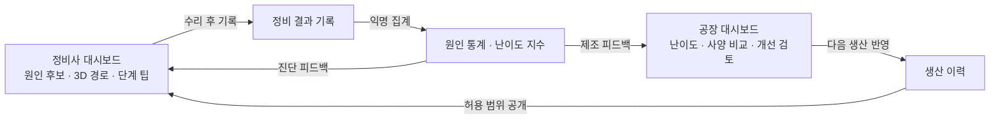
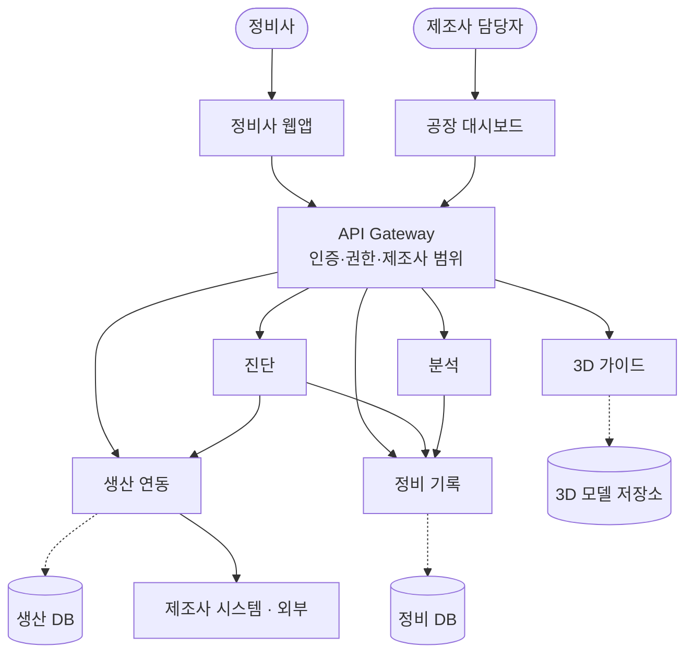

# Repair Thread · 차량 고장코드 기반 3D 정비 지원 서비스

> LG CNS AM INSPIRE CAMP 6기 해커톤 · 5팀 팩토리 도메인 (2026-11-09 ~ 11-10)

-64748b)

**공장은 조립하기 쉬운 차를 만들지만, 그 차가 얼마나 고치기 어려운지는 모른다.**

정비 결과 한 건이 다음 정비사의 점검 추천과 공장의 설계 지표를 동시에 바꾸는 양방향 루프를 만든다.

## 문제

- 자동화·모듈화로 차량 설계가 조립 효율(DFA) 중심이 되면서, 같은 차종도 사양·생산 시기마다 구조가 달라짐
- 고장코드는 문제 영역만 알려주고, 원인 부품과 접근 경로는 정비사 경험에 의존함
- 그래서 정비 시간과 품질이 경력에 따라 크게 갈림
- 제조사는 오류코드만 받고 실제 원인 부품과 정비 난이도를 모른 채 같은 설계를 반복함

| 사용자 | 역할 |
| --- | --- |
| 독립 정비소 정비사 (메인) | 특히 경력이 짧은 신입. 여러 차종을 다루지만 제조사 직영망만큼 상세한 정보가 없음 |
| 제조사 생산기술·설계 담당자 (보조) | 오류코드만 받고 실제 원인 부품과 정비 난이도는 모름 |
| 차량 소유자 (이해관계자) | 수리 과정이 안 보여 비용·심리 부담 |

## 해결

- **왼쪽 루프 (진단 피드백)**: 기록이 쌓일수록 다음 정비사가 보는 A② 관측 원인 비율이 정확해짐
- **오른쪽 루프 (제조 피드백)**: 같은 기록이 공장 지표가 되어 B④ 개선 검토의 근거가 되고, 다음 생산 차수로 이어짐
- 아래 남색 블록은 실제 API와 집계 규칙 ([API 명세](docs/api-spec.md))

텍스트 버전 (Mermaid)

### 정비사 대시보드

| # | 기능 | 내용 |
| --- | --- | --- |
| A① | 차량·고장코드 입력 | VIN → 차종·사양·생산 시기·공장 자동 표시, 고장코드 다중 입력, 증상 선택 |
| A② | 점검 우선순위 | 제조사 공식 진단 순서 + 같은 사양의 관측 원인 비율(분자·n 표시, 30건 미만은 참고용) |
| A③ | 3D 접근 경로 | 분해 단계 재생, 단계마다 탈거 부품 강조, 체결 방식, 고전압 경고·잠금, 예상 시간, 단계 팁·제조사 답변 |
| A④ | 정비 결과 기록 | 실제 원인 부품, 소요 시간, 막힌 단계, 모듈 교체 여부, 메모 (피드백 루프 시작점) |
| A⑤ | 신입 모드 | 단계별 체크리스트와 주의사항 (선택) |

### 공장·설계 담당자 대시보드

| # | 기능 | 내용 |
| --- | --- | --- |
| B① | 정비 난이도 지표 | 부품별 평균 정비 시간, 표준 대비 초과율, TOP N, 모듈 교체 비율 |
| B② | 사양·생산 조건 비교 | 같은 부품의 사양·생산 시기·라인별 정비 시간 차이 |
| B③ | 고장 다발 분석 | 고장코드별 실제 원인 분포, 특정 사양·시기 집중 탐지 |
| B④ | 개선 검토 근거 | 체결 방식·조립 순서 변경 검토 제안, 개선 전후 비교 (선택) |

### MVP 구현 순서

1. A① A② A③: 진단 + 접근 경로
2. A④ + B①: 피드백 루프
3. B② B③: 분석 깊이
4. 나머지 선택 기능

## 아키텍처 (C4 Level 2)

실선은 호출, 점선은 서비스가 소유한 저장소, 빨간 선은 분석 서비스의 정비 기록 집계 조회. A·B는 정비사·공장 대시보드, 기술 스택이 정해지지 않은 요소는 글자 배지로 표시함.

텍스트 버전 (Mermaid)

- 마이크로서비스 5개, 서비스 간에는 ID만 참조하고 다른 서비스 DB를 직접 조인하지 않음
- 진단·분석 서비스는 자체 DB 없이 다른 서비스를 호출 (분석은 정비 DB 집계 조회)
- Spring Boot 계층: Controller → Application Service → Domain Service → Repository / External API Client

## 배포 (AWS · EKS)

- 배포 단위는 Deployment 11개: 위 서비스 5개에 auth·knowledge를 더 나누고, 웹앱 2개와 제조사 시스템 mock까지 파드로 올림 (D22)
- 동시 접속이 적다는 전제로 평소엔 최소로 떠 있다가 몰릴 때만 늘어남
  - 파드: HPA로 최소 1개부터 늘고 줄며, 공장 대시보드·분석·mock은 시연 시간에만 켜짐 (KEDA cron)
  - 노드: EKS Auto Mode가 필요한 만큼 Spot 노드를 붙이고 빈 노드는 합침
  - DB: Aurora Serverless v2가 놀 때 0 ACU로 일시정지
- EKS 컨트롤 플레인·ALB·NAT는 사용량과 상관없이 과금돼서 시연 후 `terraform destroy`
- 자세한 내용은 [EKS 배포 기획](docs/deployment-eks.md)

## 핵심 결정

| 결정 | 이유 |
| --- | --- |
| AI·LLM 없이 통계와 공개 규칙으로 계산 | 정비·안전 정보는 근거를 추적할 수 있어야 정비사도 제조사도 믿음 |
| 질문 게시판 대신 3D 단계 팁 | 정비사는 작업 중이라 글을 쓸 여유가 없음. 보는 자리에 답이 있어야 함 |
| 공정 정보 비공개 + 익명 집계 | 제조사가 데이터를 내놓을 수 있는 최소 안전장치 |
| 관측 비율은 고장 발생률이 아님, 공식 순서는 유지 | 원인이 확인된 완료 건만 분모, 필수 공식 선행 순서는 바꾸지 않음 |
| 시범 범위: 사양 1종 + 대표 고장코드 1개 | 해커톤에서 과장 없이 검증 가능한 범위 |
| Kubernetes + 늘었다 줄었다 하는 구조 | 동시 접속이 적어서 평소엔 최소로 두고, 서비스는 나눠서 따로 배포·확장 |

전체 결정 이력(D1~D22)은 [기획서 9장](docs/planning.md#9-의사결정-로그)에 있음.

## 문서

| 문서 | 내용 |
| --- | --- |
| [docs/planning.md](docs/planning.md) | 기획서 전체: 문제 정의, 근거, 페르소나, 벤치마킹, 기능 정의, 유스케이스, 화면, 정책, 결정 로그, 지표, Q&A, 개발용 다이어그램 |
| [docs/api-spec.md](docs/api-spec.md) | API 명세 초안 7개와 관련 정책 |
| [docs/data-dictionary.md](docs/data-dictionary.md) | 테이블 14개, 소유 서비스·저장소 |
| [docs/test-plan.md](docs/test-plan.md) | 테스트케이스 53개 (P0 24개), 경계값 픽스처, 시연 리허설 순서 |
| [docs/deployment-eks.md](docs/deployment-eks.md) | AWS·EKS 배포 기획: 서비스 분리, 탄력 설계, 매니페스트 예시, CI/CD, 비용·리스크 |
| [docs/images/src/](docs/images/src) | 그림 원본: 구성도 스펙(JSON), 루프 다이어그램(Excalidraw) |

## 상태

- [x] 기획 (문제 정의, 기능 정의, 유스케이스, 정책, 아키텍처)
- [x] API 명세·데이터 사전 초안
- [x] 테스트케이스 기획
- [x] AWS·EKS 배포 기획
- [ ] Acceptance Criteria
- [ ] Repository 구조 · Git Branch 전략
- [ ] 구현 (MVP 1순위부터)

> 데모의 차량(PBV-X)과 정비 기록은 모두 가상 데이터임.
