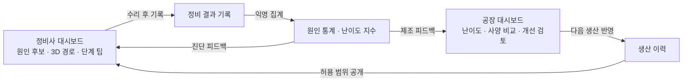

# Repair Thread · 차량 고장코드 기반 3D 정비 지원 서비스

> LG CNS AM INSPIRE CAMP 6기 해커톤 · 5팀 팩토리 도메인 (2026-11-09 ~ 11-10)

**공장은 조립하기 쉬운 차를 만들지만, 그 차가 얼마나 고치기 어려운지는 모른다.**

정비 결과 한 건이 다음 정비사의 점검 추천과 공장의 설계 지표를 동시에 바꾸는 양방향 루프를 만든다.

## 문제

- 자동화·모듈화로 차량 설계가 조립 효율(DFA) 중심이 되면서, 같은 차종도 사양·생산 시기마다 구조가 달라짐
- 고장코드는 문제 영역만 알려주고, 원인 부품과 접근 경로는 정비사 경험에 의존함
- 그래서 정비 시간과 품질이 경력에 따라 크게 갈림
- 제조사는 오류코드만 받고 실제 원인 부품과 정비 난이도를 모른 채 같은 설계를 반복함

| 사용자 | 역할 |
| --- | --- |
| 독립 정비소 정비사 (메인) | 특히 경력이 짧은 신입. 여러 차종을 다루지만 제조사 직영망만큼 상세한 정보가 없음 |
| 제조사 생산기술·설계 담당자 (보조) | 오류코드만 받고 실제 원인 부품과 정비 난이도는 모름 |
| 차량 소유자 (이해관계자) | 수리 과정이 안 보여 비용·심리 부담 |

## 해결

### 정비사 대시보드

| # | 기능 | 내용 |
| --- | --- | --- |
| A① | 차량·고장코드 입력 | VIN → 차종·사양·생산 시기·공장 자동 표시, 고장코드 다중 입력, 증상 선택 |
| A② | 점검 우선순위 | 제조사 공식 진단 순서 + 같은 사양의 관측 원인 비율(분자·n 표시, 30건 미만은 참고용) |
| A③ | 3D 접근 경로 | 분해 단계 재생, 단계마다 탈거 부품 강조, 체결 방식, 고전압 경고·잠금, 예상 시간, 단계 팁·제조사 답변 |
| A④ | 정비 결과 기록 | 실제 원인 부품, 소요 시간, 막힌 단계, 모듈 교체 여부, 메모 (피드백 루프 시작점) |
| A⑤ | 신입 모드 | 단계별 체크리스트와 주의사항 (선택) |

### 공장·설계 담당자 대시보드

| # | 기능 | 내용 |
| --- | --- | --- |
| B① | 정비 난이도 지표 | 부품별 평균 정비 시간, 표준 대비 초과율, TOP N, 모듈 교체 비율 |
| B② | 사양·생산 조건 비교 | 같은 부품의 사양·생산 시기·라인별 정비 시간 차이 |
| B③ | 고장 다발 분석 | 고장코드별 실제 원인 분포, 특정 사양·시기 집중 탐지 |
| B④ | 개선 검토 근거 | 체결 방식·조립 순서 변경 검토 제안, 개선 전후 비교 (선택) |

### MVP 구현 순서

1. A① A② A③: 진단 + 접근 경로
2. A④ + B①: 피드백 루프
3. B② B③: 분석 깊이
4. 나머지 선택 기능

## 아키텍처 (C4 Level 2)

- 마이크로서비스 5개, 서비스 간에는 ID만 참조하고 다른 서비스 DB를 직접 조인하지 않음
- 진단·분석 서비스는 자체 DB 없이 다른 서비스를 호출 (분석은 정비 DB 집계 조회)
- Spring Boot 계층: Controller → Application Service → Domain Service → Repository / External API Client

## 핵심 결정

| 결정 | 이유 |
| --- | --- |
| AI·LLM 없이 통계와 공개 규칙으로 계산 | 정비·안전 정보는 근거를 추적할 수 있어야 정비사도 제조사도 믿음 |
| 질문 게시판 대신 3D 단계 팁 | 정비사는 작업 중이라 글을 쓸 여유가 없음. 보는 자리에 답이 있어야 함 |
| 공정 정보 비공개 + 익명 집계 | 제조사가 데이터를 내놓을 수 있는 최소 안전장치 |
| 관측 비율은 고장 발생률이 아님, 공식 순서는 유지 | 원인이 확인된 완료 건만 분모, 필수 공식 선행 순서는 바꾸지 않음 |
| 시범 범위: 사양 1종 + 대표 고장코드 1개 | 해커톤에서 과장 없이 검증 가능한 범위 |

전체 결정 이력(D1~D21)은 [기획서 9장](docs/planning.md#9-의사결정-로그)에 있음.

## 문서

| 문서 | 내용 |
| --- | --- |
| [docs/planning.md](docs/planning.md) | 기획서 전체: 문제 정의, 근거, 페르소나, 벤치마킹, 기능 정의, 유스케이스, 화면, 정책, 결정 로그, 지표, Q&A, 개발용 다이어그램 |
| [docs/api-spec.md](docs/api-spec.md) | API 명세 초안 7개와 관련 정책 |
| [docs/data-dictionary.md](docs/data-dictionary.md) | 테이블 14개, 소유 서비스·저장소 |

## 상태

- [x] 기획 (문제 정의, 기능 정의, 유스케이스, 정책, 아키텍처)
- [x] API 명세·데이터 사전 초안
- [ ] Acceptance Criteria
- [ ] Repository 구조 · Git Branch 전략
- [ ] 구현 (MVP 1순위부터)

> 데모의 차량(PBV-X)과 정비 기록은 모두 가상 데이터임.
