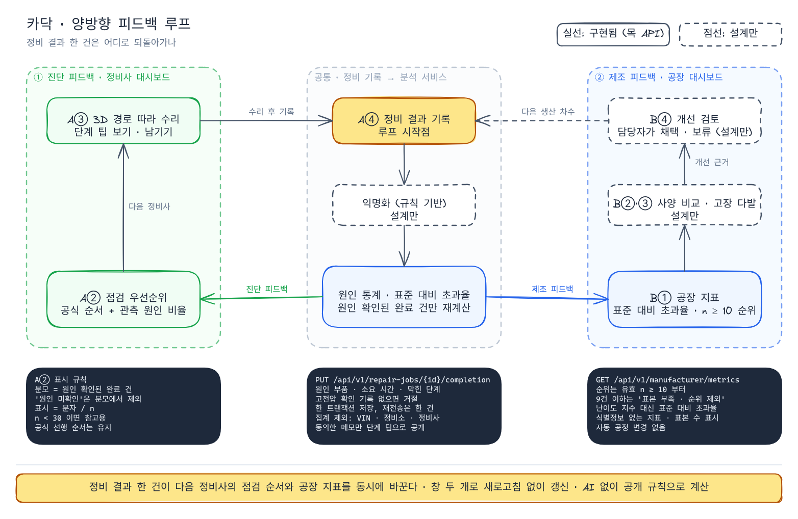
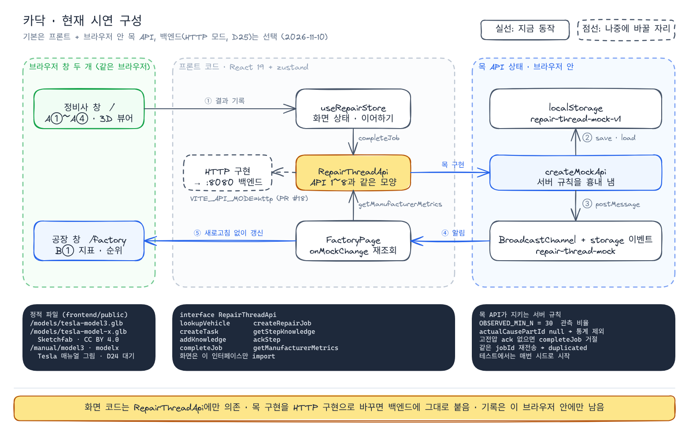
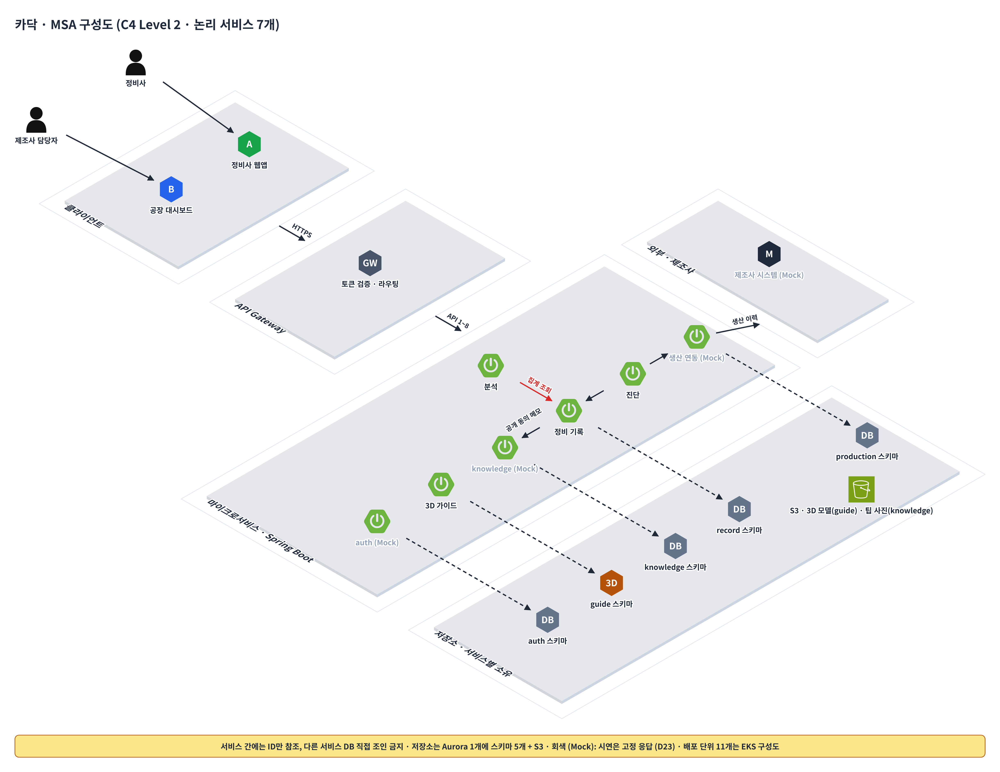
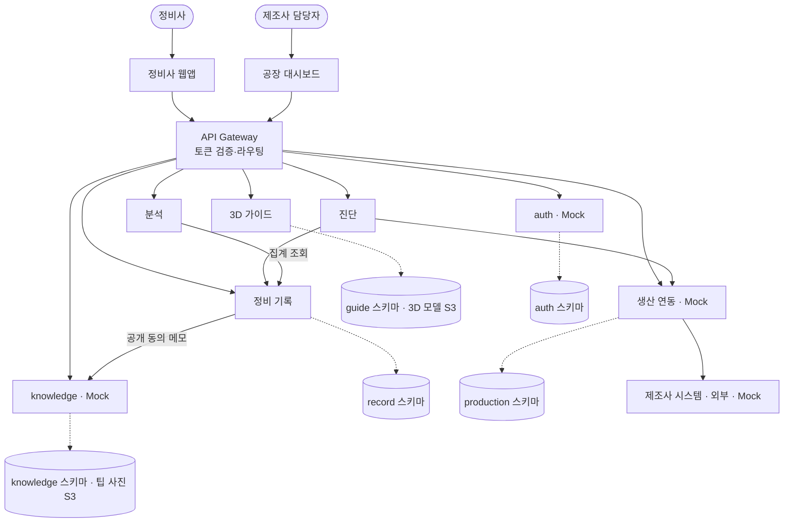
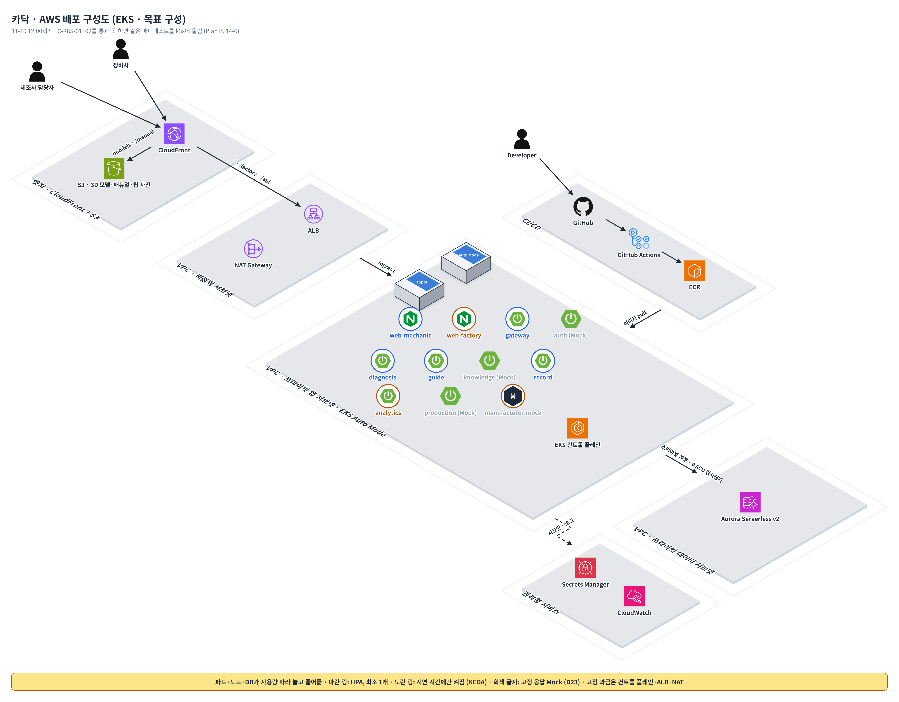

<div align="center">

# 카닥

차량 고장코드 기반 3D 정비 지원 서비스

LG CNS AM INSPIRE CAMP 6기 해커톤 · 5팀 팩토리 · 2026-11-09 ~ 11-10


-64748b)

*공장은 조립하기 쉬운 차를 만들지만, 그 차가 얼마나 고치기 어려운지는 모른다.*

[빠른 시작](#빠른-시작) · [데모 시나리오](#3-데모-시나리오) · [기획서](docs/planning.md) · [테스트 기획](docs/test-plan.md)

</div>

> 한 문장 요약
> 독립 정비소의 신입 정비사가 처음 보는 전기차의 고장코드를 받았을 때, 어디부터 점검하고 어떻게 분해할지 몰라 작업 시간이 늘어나는 문제를, 제조사 공식 진단 순서와 같은 사양의 관측 원인 비율, 3D 분해 경로로 풀고, 그 정비 결과를 제조사의 설계 지표로 돌려준다.

## 목차

- [한눈에 보기](#한눈에-보기)
- [빠른 시작](#빠른-시작)
- [1. Problem & Target](#1-problem--target)
- [2. Solution & Experience](#2-solution--experience)
- [3. 데모 시나리오](#3-데모-시나리오)
- [4. 구현 현황: 실제 구현 · Mock · 설계만](#4-구현-현황-실제-구현--mock--설계만)
- [5. Technical Design](#5-technical-design)
- [6. 테스트](#6-테스트)
- [7. Key Decisions](#7-key-decisions)
- [8. 진행 상태와 다음 단계](#8-진행-상태와-다음-단계)
- [9. 문서](#9-문서)
- [10. 출처와 라이선스](#10-출처와-라이선스)
- [11. 팀](#11-팀)

## 한눈에 보기

| | |
| --- | --- |
| 누구 | 독립 정비소의 신입 정비사 (메인), 제조사 생산기술·설계 담당자 (보조) |
| 언제 | 처음 보는 전기차에서 고장코드를 받았을 때 |
| 문제 | 고장코드는 영역만 알려줘서 어디부터 점검할지, 무엇을 먼저 떼야 할지 경험에 의존함 |
| 해결 | 공식 진단 순서 + 같은 사양의 관측 원인 비율로 점검 순서를 잡고, 고른 부품까지 3D로 분해 경로를 보여줌 |
| 팩토리 연결 | 정비 결과 한 건이 공장의 정비 난이도 지표가 되어 다음 설계·공정 검토의 근거가 됨 |
| 핵심 장면 | 결과 기록을 한 건 제출하면 정비사 화면의 관측 비율과 공장 화면의 지표가 같이 바뀜 |
| 시연 차량 | Tesla Model 3, Model X (공개 서비스 매뉴얼 기준 절차, 숫자는 예시 데이터) |

## 빠른 시작

백엔드 없이 프론트엔드와 목 API만으로 돌아감. Node.js 24 LTS 기준.

```sh
git clone https://github.com/salieri009/LG_CNS_AM_INSPIRE.git
cd LG_CNS_AM_INSPIRE/frontend
npm ci
npm run dev -- --port 5180 --strictPort
```

| 화면 | 주소 |
| --- | --- |
| 정비사 | http://localhost:5180/ |
| 공장·설계 | http://localhost:5180/factory |

```sh
npm test        # Vitest
npm run lint    # oxlint
npm run build   # tsc -b + vite build
```

- 목 상태는 브라우저 `localStorage`에 남아 같은 브라우저의 창끼리 공유됨. 초기화: `localStorage.removeItem('repair-thread-mock-v1')`
- 자세한 실행 안내와 시연 순서: [docs/local-preview.md](docs/local-preview.md)

## 1. Problem & Target

자동화·모듈화로 차량 설계가 조립 효율(DFA) 중심이 되면서, 같은 차종도 사양·생산 시기마다 구조가 달라짐. 그런데 정비 현장에는 이 차이가 차 한 대 단위로 전달되지 않음.

- 고장코드는 문제 영역만 알려주고, 원인 부품과 접근 경로는 정비사 경험에 의존함
  - 대형 트럭 제조사 데이터 885건에서 고장코드만 쓴 모델의 원인 분류 정확도는 최고 58.0%, 증상을 함께 쓰면 68.8% (Zafar 외 2026, 사전공개 논문)
- 그래서 정비 시간과 품질이 경력에 따라 크게 갈림
  - 미국 독립 정비소는 정보 부족으로 한 달에 최대 5대를 딜러로 넘긴다는 조사가 있음 ([ACA 조사](https://www.fleetmaintenance.com/equipment/government-and-regulations/article/55384908/right-to-repair-independent-shops-access-to-repair-data))
- 제조사는 오류코드만 받고 실제 원인 부품과 정비 난이도를 모른 채 같은 설계를 반복함
- 출발점: 팀원 지인인 현직 정비사가 부품이 예상한 위치에 없거나 접근 방식이 달라 작업이 늦어진 경험

| 사용자 | 상황 | 바라는 것 |
| --- | --- | --- |
| 신입 정비사 "김 주임" (메인, 가상) | 정비 2년, 전기차 경험 거의 없음 | 처음 보는 구조도 혼자, 재작업 없이 |
| 생산기술 "이 책임" (보조, 가상) | 오류코드의 실제 원인 부품과 정비 난이도를 모름 | 정비하기 어려운 구조를 숫자로 파악 |
| 차량 소유자 (이해관계자) | 수리 과정이 안 보임 | 견적과 작업을 믿을 근거 |

근거 자료와 반례(자동화 구조라도 수리성을 설계에 반영하면 수리비가 낮아진 Thatcham 연구)는 [기획서 2장](docs/planning.md#2-리서치-근거-자료집)에 있음.

## 2. Solution & Experience



- 진단 피드백 (왼쪽): 기록이 쌓일수록 다음 정비사가 보는 관측 원인 비율이 정확해짐
- 제조 피드백 (오른쪽): 같은 기록이 공장 지표가 되어 개선 검토의 근거가 되고, 다음 생산 차수로 이어짐
- 실선은 지금 목 API로 동작하는 부분, 점선(익명화, B②·B③ 사양 비교·고장 다발, B④ 개선 검토)은 설계만 한 부분

### 핵심 기능 3개

| 기능 | 하는 일 | 왜 필요한가 |
| --- | --- | --- |
| A② 점검 우선순위 | 제조사 공식 진단 순서를 기본으로, 같은 사양의 관측 원인 비율을 분자·n과 함께 표시 (사례 n 30건 미만은 참고용). 점검했는데 원인이 아니면 지우고 다음 후보로 | "어디부터 보나"에 답함 |
| A③ 3D 분해 경로 | 고른 부품까지 분해 단계를 3D로 재생, 단계마다 체결 방식·토크·예상 시간·탈거 부품 강조, 고전압 단계는 확인 전 잠금. 단계 시간은 자동으로 재고 막힌 이유·팁을 그 자리에서 남김 | 무엇을 먼저 떼야 하는지 작업 전에 보임 |
| A④ 결과 기록 | 실제 원인 부품(또는 원인 미확인), 소요 시간, 막힌 단계, 모듈 교체 여부를 1분 안에 기록 | 루프가 도는 시작점. A②와 공장 지표 B①을 동시에 갱신 |

사용자 흐름 (INPUT → PROCESS → OUTPUT): VIN·고장코드 입력 → 공식 순서 + 같은 사양 완료 기록 집계로 후보 정렬, 고른 부품의 3D 분해 단계 구성 → 점검 순서와 3D 경로 확인, 기록 제출 뒤 관측 비율과 공장 지표 갱신 확인

<details>
<summary>전체 기능 목록 (정비사 A①~⑤, 공장 B①~④)</summary>

| # | 기능 | 내용 | 지금 |
| --- | --- | --- | --- |
| A① | 차량·고장코드 입력 | VIN → 차종·사양·생산 시기 표시, 차종별 자주 검색된 고장코드 | 구현 (목 API) |
| A② | 점검 우선순위 | 공식 진단 순서 + 관측 원인 비율, 순서대로 지우기 | 구현 (목 API) |
| A③ | 3D 분해 경로 | 단계 재생, 체결 방식, 고전압 잠금, 매뉴얼 그림, 단계 기록·팁 | 구현 (목 API) |
| A④ | 정비 결과 기록 | 원인 부품·미확인, 시간, 막힌 단계, 모듈 교체, 장착 뒤 할 일 확인 | 구현 (목 API) |
| A⑤ | 신입 모드 | 단계별 체크리스트 | 발표에서만 |
| B① | 정비 난이도 지표 | 부품별 평균 시간, 표준 대비 초과율, 모듈 교체 비율, 3D 위 난이도 밝기 | 구현 (목 API) |
| B② | 사양·생산 조건 비교 | 같은 부품의 사양·시기·라인별 시간 차이 | 미구현 |
| B③ | 고장 다발 분석 | 고장코드별 실제 원인 분포, 집중 탐지 | 미구현 |
| B④ | 개선 검토 근거 | 체결 방식·조립 순서 변경 검토 제안 | 발표에서만 |

</details>

## 3. 데모 시나리오

Tesla Model 3, 고장코드 B1A24 (리어 왼쪽 도어 래치, 예시 코드). 정비사 창(`/`)과 공장 창(`/factory`)을 나란히 띄워 두고 시작함.

1. 차량을 고르고 고장코드 B1A24 선택 → 차종·사양·생산 시기가 표시됨 (A①)
2. 점검 우선순위: 공식 순서 1순위 리어 도어 래치, "관측 25/48건 (52%)" (A②)
3. 1순위 부품까지 3D 분해 7단계 재생. 단계 시간이 자동으로 재짐 (A③)
4. 결과 기록 제출: 실제 원인, 걸린 시간, 막힌 단계 (A④)
5. 정비사 화면의 n이 48 → 49로 바뀌고, 공장 창의 리어 도어 래치 지표가 새로고침 없이 갱신됨 (B①)

- 고전압 잠금은 P0A3F(구동 모터 위치 센서) 사례 1단계에서 보여줌
- 같은 B1A24라도 Model X는 팰컨 윙 래치 10단계 절차가 나옴. VIN 단위 안내가 필요한 이유를 보여주는 장면
- 숫자는 모두 예시 데이터이고, 분모는 원인이 확인된 완료 건만 셈. 관측 비율이지 고장 발생률이 아님

## 4. 구현 현황: 실제 구현 · Mock · 설계만

해커톤 가이드의 "작은 프로토타입" 기준에 맞춰 데모 루프에 필요한 것만 만듦 ([D23](docs/planning.md#9-의사결정-로그)).

| 구분 | 내용 |
| --- | --- |
| 실제 구현 | 프론트엔드 정비사·공장 화면, 3D 뷰어 (React 19 + react-three-fiber), 상태 관리 (zustand) |
| Mock | 백엔드 서비스 전체를 같은 인터페이스(`RepairThreadApi`)의 목 API로 대체. 시드 사례 8개, 차량 2대, 단계 팁 12건. 상태는 브라우저 `localStorage` |
| 설계만 | Spring Boot 마이크로서비스, EKS 배포, 신입 모드, 개선 제안, 팁 추천·신고, 실제 제조사 연동 |



화면 코드는 `RepairThreadApi` 인터페이스에만 의존함. 지금은 목 구현이 붙어 있고, 백엔드가 생기면 같은 인터페이스의 HTTP 구현으로 바꿈.

## 5. Technical Design

### 아키텍처 (C4 Level 2)



- 논리 서비스 7개: 진단, 3D 가이드, 정비 기록, 분석, 생산 연동에 auth와 knowledge를 나눔 (D22). 배포 단위는 웹앱 2개·Gateway·제조사 mock까지 11개
- 회색 글자(auth, knowledge, 생산 연동, 제조사 시스템)는 시연에서 고정 응답 Mock (D23)
- 서비스 간에는 ID만 참조하고 다른 서비스 DB를 직접 조인하지 않음. 저장소는 Aurora 클러스터 1개에 스키마 5개 + S3
- 진단·분석은 자체 DB 없이 다른 서비스를 호출함 (분석은 정비 DB 집계 조회)
- Spring Boot 계층: Controller → Application Service → Domain Service → Repository / External API Client
- 프론트는 화면 코드가 `RepairThreadApi` 인터페이스에만 의존해서, 목 API를 HTTP 구현으로 바꾸면 백엔드에 그대로 붙음

<details>
<summary>텍스트 버전 (Mermaid)</summary>



</details>

### 배포 (AWS · EKS)



- 목표 구성. 지금 시연은 위 [현재 시연 구성](#4-구현-현황-실제-구현--mock--설계만)처럼 브라우저 안에서 돎
- Deployment 11개를 EKS Auto Mode 클러스터 하나에서 관리, 동시 접속이 적다는 전제로 파드(HPA·KEDA cron)·노드(Spot)·DB(Aurora Serverless v2)가 사용량 따라 늘고 줆
- EKS 컨트롤 플레인·ALB·NAT는 사용량과 상관없이 과금돼서 시연 후 `terraform destroy`
- 시간 게이트: 11-10 12:00까지 TC-K8S-01·02를 통과 못 하면 같은 매니페스트를 k3s에 올림
- 자세한 내용: [EKS 배포 기획](docs/deployment-eks.md)

### API · 데이터

| 항목 | 규모 | 문서 |
| --- | --- | --- |
| API | 8개 (`/api/v1/vehicle-lookups` ~ `/api/v1/manufacturer/metrics`, 단계 팁 남기기) | [api-spec.md](docs/api-spec.md) |
| 데이터 | 테이블 15개, 서비스별 소유 | [data-dictionary.md](docs/data-dictionary.md) |

### 프로젝트 구조

```text
.
├── frontend/              React 19 + TypeScript + Vite
│   ├── public/models/     3D 모델 (GLB)
│   ├── public/manual/     매뉴얼 그림 (출처는 10장)
│   └── src/
│       ├── api/           RepairThreadApi 인터페이스와 목 API
│       ├── mocks/         차종·고장코드별 시드 사례
│       ├── store/         진단 흐름 상태 (zustand)
│       ├── pages/         정비사 화면, 공장 화면
│       ├── components/    패널, 결과 기록, 단계 기록
│       └── viewer/        3D 뷰어 (react-three-fiber)
└── docs/                  기획서, API 명세, 데이터 사전, 테스트·배포 기획, 그림
```

## 6. 테스트

| 항목 | 현황 |
| --- | --- |
| 자동 테스트 | 69개 통과 (Vitest, 파일 11개), lint·build 통과 (master 기준). 최신 PR #21·#22·#23까지 합치면 93개 (백엔드 PR은 H2 통합 14개 + 모듈 경계 1개) |
| 테스트케이스 | 69개, 시연 전 필수 P0 17개 중 12개 통과 |
| 브라우저 확인 | 정비사 창에서 기록 → 공장 창 지표가 새로고침 없이 갱신 (n 41 → 42) |

남은 P0: 관측 비율 경계(사례 n 29/30), 출처 표기, 배포 검증. 전체 목록은 [테스트 기획](docs/test-plan.md).

## 7. Key Decisions

해커톤 가이드의 "처음 생각 → 확인한 내용 → 바뀐 판단" 형식. 전체 24개는 [기획서 9장](docs/planning.md#9-의사결정-로그)에 있음.

| # | 처음 생각 | 확인한 내용 | 바뀐 판단 |
| --- | --- | --- | --- |
| D19 | LLM으로 메모 구조화, 팁 요약, 개선 제안 | 팀 시나리오엔 AI가 없음. 정비·안전 정보는 근거를 추적할 수 있어야 함 | AI 전면 제외. 통계·공개 규칙으로 계산 |
| D17 | 질문을 쓰는 Q&A 게시판 | 정비사는 작업 중이라 글을 쓸 여유가 없음 | 3D 단계 툴팁의 팁이 답변 역할 |
| D20 | 원인 후보를 고장 다발 확률 순으로 정렬 | 관측 비율은 고장 발생률이 아님. 공식 진단 순서가 우선 | 공식 순서 기본, 관측 비율·n은 근거로 표시 |
| D23 | 서비스 11개를 모두 구현하고 탄력 구조까지 시연 | 핵심 기능 1~3개, 실제 구현·Mock 구분 기준. 남은 시간 약 하루 | 데모 루프만 실제 구현, 나머지는 Mock |
| D24 | 가상 차량 PBV-X 1종 | 공개 서비스 매뉴얼로 실제 절차를 확보함. 그림·3D 모델 재배포 허락은 미확인 | Tesla Model 3·X로 시연, 숫자는 예시. 출처 처리는 팀 결정 대기 |

## 8. 진행 상태와 다음 단계

- [x] 기획: 문제 정의, 근거, 기능, 유스케이스, 정책, 아키텍처
- [x] API 명세·데이터 사전, 테스트케이스 기획, AWS·EKS 배포 기획
- [x] 해커톤 가이드 기준 리뷰와 반영 ([리뷰](docs/review-mentor-guide.md))
- [x] 프론트엔드: 정비사·공장 화면, 3D 뷰어, 목 API (PR #2·#6~#9 머지)
- [x] 3D 모델 출처 등록 (Sketchfab, CC BY 4.0)
- [ ] 매뉴얼 그림 공개 범위 (D24, 팀 결정)
- [ ] 남은 P0 테스트, 데모 전 측정 ([기획서 10장](docs/planning.md#10-기대효과와-지표))
- [ ] 리허설 3회 연속 통과

다음 단계 (해커톤 이후): Spring Boot 백엔드, 실제 정비사 검증, 제조사 데이터 제휴, 진단기 연동

## 9. 문서

| 문서 | 내용 |
| --- | --- |
| [기획서](docs/planning.md) | 문제 정의부터 발표 구성까지 15장 |
| [API 명세](docs/api-spec.md) | API 8개와 권한·안전·집계 정책 |
| [데이터 사전](docs/data-dictionary.md) | 테이블 15개, 소유 서비스·저장소 |
| [테스트케이스 기획](docs/test-plan.md) | 69개 (P0 17개), 상태와 근거, 리허설 순서 |
| [EKS 배포 기획](docs/deployment-eks.md) | 서비스 분리, 탄력 설계, 매니페스트 예시, CI/CD, 비용·리스크 |
| [가이드 기준 리뷰](docs/review-mentor-guide.md) | 8항목 판정, 체크리스트, 범위 칼질, 발표·Q&A |
| [로컬 실행 안내](docs/local-preview.md) | 설치·실행, 확인할 흐름, 검증 |
| [그림 원본](docs/images/src) | 구성도 스펙(JSON), 루프 다이어그램(Excalidraw) |

## 10. 출처와 라이선스

- 정비 절차·토크·공구·그림: [Tesla Model 3](https://service.tesla.com/docs/Model3/ServiceManual/en-us/) · [Model X](https://service.tesla.com/docs/ModelX/ServiceManual/Palladium/en-us/) Service Manual 참고. 그림의 저작권은 Tesla에 있음. 저장소 공개 범위는 팀 결정 대기 (D24)
- 3D 모델 (Sketchfab, [CC BY 4.0](https://creativecommons.org/licenses/by/4.0/)). 웹용으로 glTF-Transform 압축·변환함. 시연 화면 왼쪽 아래에도 같은 표기가 있음
  - Model 3: ["Tesla model 3"](https://sketchfab.com/3d-models/tesla-model-3-5af35a4772f240039a6e58c58998555b) by [dannzjs](https://sketchfab.com/dannzjs)
  - Model X: ["Tesla Model X"](https://sketchfab.com/3d-models/tesla-model-x-5c08f723bfc94a98b7d7918e3e4ff1dc) by [David_Holiday](https://sketchfab.com/David_Holiday)
- VIN, 고장코드 번호, 건수, 시간, 팁, 인물은 모두 예시 데이터임. 실제 진단·정비에 쓰지 않음

## 11. 팀

5팀 · 팩토리 (9명): 김민서, 김승진, 김예림, 박재후, 박준우, 반정욱, 서정운, 최규성, 홍준서
