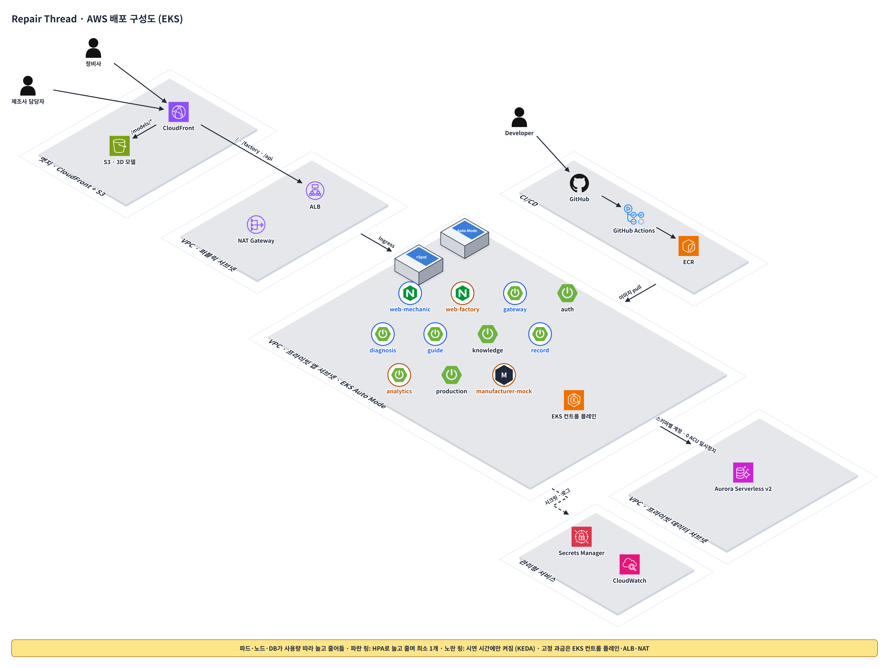

# AWS 배포 기획 (Kubernetes · EKS)

> [기획서 14장](planning.md#14-aws-배포-기획-kubernetes--eks)과 같은 내용. 장 번호는 [기획서](planning.md) 기준이고, 배포 검증 테스트는 [테스트케이스 기획](test-plan.md#13-5-배포-검증-kubernetes) 참고. 구성도 원본 스펙은 [images/src/aws-eks.json](images/src/aws-eks.json).

서비스를 Deployment 11개로 나눠 서울 리전(ap-northeast-2) EKS Auto Mode 클러스터 하나에서 관리하고, 파드·노드·DB가 사용량에 따라 늘고 줄게 함 (14-3). 사용자 진입은 CloudFront 하나, 3D 모델은 S3, DB는 Aurora Serverless v2에 서비스별 스키마. 사양과 숫자는 해커톤 시연 기준 제안임. 프론트는 React 19 + Vite(정적 파일), 백엔드는 지금 MySQL 8.4로 개발 중이라(PR #18, D25) Aurora도 MySQL 호환을 기본으로 둠 (팀 확인 필요).

> 공개 시연판: EKS와 별개로 프론트만 Vercel 정적 사이트로 올림 (`npm run build:public`, Tesla 매뉴얼 그림 제외, 백엔드 없이 목 API). 주소는 `https://jnnxeo-cardoc.vercel.app`(master 연결 뒤), 팀원 40명이 20분 함께 써도 Hobby 한도(월 100GB) 안. 자세한 건 [deploy-vercel.md](./deploy-vercel.md) (PR #25).

## 14-1. 서비스 분리 (D22)

> D25: 지금 백엔드는 모듈러 모놀리스 1개(PR #18)라, 아래 표는 모듈을 서비스로 떼어 낼 때의 목표 배포 단위임. 시연 배포를 백엔드 1개 + 웹으로 줄일지는 팀 확인 필요.

12-1의 서비스 5개에서 auth와 knowledge를 더 나누고, 웹앱 2개와 제조사 시스템 대역(mock)도 파드로 올림. 해커톤 시연에서는 이 중 7개만 실제 코드이고, auth·knowledge·production·manufacturer-mock은 고정 응답 Mock임 (5장, D23).

| Deployment | 역할 | 12-1 기준 | 저장소 | 레플리카 (최소\~최대) |
| --- | --- | --- | --- | --- |
| web-mechanic | 정비사 웹앱 정적 파일 (Nginx) | 정비사 웹앱 | 없음 | 1\~3 |
| web-factory | 공장 대시보드 정적 파일 (Nginx) | 공장 대시보드 | 없음 | 0\~2 (시연 시간만 켬) |
| gateway | 라우팅, 토큰 검증, 제조사 범위 전달 | API Gateway | 없음 | 1\~3 |
| auth (분리) | 로그인, 토큰 발급, 권한 등급 L1\~L3 | Gateway 인증 | auth 스키마 (APP\_USER) | 1\~2 |
| diagnosis | A① A② 원인 후보·점검 순서 | 진단 | diagnosis 스키마 (DIAGNOSTIC\_RULE 참조 데이터, 시드로 적재). 사양·이력은 호출 | 1\~4 |
| guide | A③ 분해 경로, 단계, 고전압 확인 | 3D 가이드 | guide 스키마 (PROCEDURE, PROCEDURE\_STEP, MODEL\_ASSET) + S3 | 1\~4 |
| knowledge (분리) | 단계 팁, 제조사 답변, 추천, 신고, 사진 (API 4) | 3D 가이드의 Step Knowledge Manager | knowledge 스키마 (KNOWLEDGE\_ENTRY, ATTACHMENT, VOTE) + S3 | 1\~2 |
| record | A④ 정비 결과, 집계 조회 API | 정비 기록 | record 스키마 (정비 DB) | 1\~3 |
| analytics | B①\~④ 지표 | 분석 | 없음 (record 집계 조회) | 0\~2 (시연 시간만 켬) |
| production | 생산 이력·사양 조회, 접근 통제 | 생산 연동 | production 스키마 (생산 DB) | 1\~2 |
| manufacturer-mock | 외부 제조사 시스템 대역, mock 네임스페이스 | 제조사 시스템 (외부) | 없음 (고정 응답) | 0\~1 (시연 시간만 켬) |

- auth를 나눈 이유: 권한 등급 규칙(8-1)을 한 곳에 두고 gateway는 토큰 검증과 라우팅만 함
- knowledge를 나눈 이유: 팁은 쓰기·추천·신고가 잦은 커뮤니티 기능이고, 3D 경로는 읽기 위주에 안전 규칙이 붙음. 배포 주기와 장애 범위를 따로 둠. 대신 웹앱이 단계와 팁 API를 병렬로 호출함 (D21의 한 번 조회 이점은 포기)
- 나누지 않은 것: record는 완료 저장을 한 트랜잭션으로 지켜야 해서 하나로 둠 (TC-A4-02·03). diagnosis·analytics는 DB가 없는 계산 서비스라 더 쪼갤 이유가 없음

## 14-2. AWS 구성 요소

| 구역 | 리소스 | 설정 (제안) |
| --- | --- | --- |
| 엣지 | CloudFront | 단일 진입점, 기본 도메인으로 HTTPS. `/models/*`는 S3, 나머지는 ALB |
| 엣지 | S3 (repair-thread-assets) | 3D 모델, 2D 대체 이미지, 팁 사진. 퍼블릭 차단, 읽기는 CloudFront OAC로만, 업로드는 서명 URL |
| VPC 10.0.0.0/16 | 퍼블릭 서브넷 2개 (2 AZ) | ALB, NAT Gateway 1개. ALB 보안 그룹은 CloudFront origin-facing 관리형 접두사 목록만 허용 |
| VPC | 프라이빗 앱 서브넷 2개 | EKS Auto Mode 노드. 인스턴스 종류와 대수는 파드 요청량에 맞춰 자동, Spot 우선 (14-3) |
| VPC | 프라이빗 데이터 서브넷 2개 | Aurora Serverless v2 클러스터 1개, 스키마 6개 (auth, diagnosis, guide, knowledge, record, production. 백엔드 Flyway 스키마와 같음). 스키마마다 DB 계정을 따로 두어 다른 서비스 테이블은 권한으로 막음 |
| 클러스터 | EKS Auto Mode | Load Balancer Controller·VPC CNI·CoreDNS를 AWS가 관리. Ingress 하나로 ALB 생성: `/` web-mechanic, `/factory` web-factory, `/api` gateway |
| 클러스터 | 네임스페이스 | repair-thread (앱 10개 + 시드 Job), mock (manufacturer-mock) |
| 관리형 | ECR | 서비스별 리포지토리, 이미지 태그 = 커밋 SHA |
| 관리형 | Secrets Manager | DB 계정, 토큰 서명 키, VIN HMAC 키. 파드는 EKS Pod Identity로 자기 것만 읽음 |
| 관리형 | CloudWatch | 컨테이너 로그, ALB 5xx 알람 |

## 14-3. 탄력 설계 (사용량 따라 늘고 줄기)

동시 접속이 적다는 전제로, 평소에는 최소로 떠 있다가 요청이 몰릴 때만 늘림. 파드, 노드, DB 세 층이 각각 따로 늘고 줌.

| 층 | 늘리는 기준 | 줄이는 방식 | 평소 최소 | 도구 |
| --- | --- | --- | --- | --- |
| 파드 | CPU 사용률 60% 초과 시 레플리카 추가 (14-1 최대값까지) | 부하가 내려가고 5분 뒤 감소 | 서비스당 1개 | HPA |
| 파드 (시간대) | 시연·리허설 시간대에만 켬 | 그 외 시간 0개 | web-factory, analytics, manufacturer-mock 0개 | KEDA cron 스케일러 |
| 노드 | 대기(Pending) 파드가 생기면 크기에 맞는 EC2 추가, Spot 우선 | 비거나 덜 쓰는 노드를 비우고 통합 | 파드가 들어갈 만큼 (보통 1\~2대) | EKS Auto Mode (AWS 관리형 Karpenter) |
| DB | 쿼리 부하에 따라 ACU 증가 | 유휴 시간이 길면 0 ACU로 일시정지 (5분\~1일 설정) | 0 ACU, 시연일은 0.5 ACU | Aurora Serverless v2 |

- 0으로 안 내리는 것: 사용자 경로(web-mechanic, gateway, diagnosis, guide, record). Spring Boot 파드는 뜨는 데 수십 초가 걸려 첫 요청이 늦어짐
- 고정으로 남는 것: EKS 컨트롤 플레인, ALB, NAT Gateway는 사용량이 0이어도 시간 과금됨 (14-6)
- Aurora 재개: 일시정지 뒤 첫 연결은 보통 약 15초, 24시간 넘게 멈췄으면 30초 이상. 커넥션 타임아웃을 그보다 길게 둠
- 레플리카 1개인 서비스에는 PodDisruptionBudget을 걸지 않음: 걸면 노드 통합이 막힘. 무중단 교체는 롤링 업데이트 maxUnavailable 0, maxSurge 1로 해결
- Spot 회수: 회수 알림이 오면 파드가 다른 노드로 옮겨지며 잠깐 끊길 수 있음. 시연일에는 사용자 경로만 온디맨드 NodePool로 고정 (선택)

```yaml
apiVersion: autoscaling/v2
kind: HorizontalPodAutoscaler
metadata:
  name: diagnosis
  namespace: repair-thread
spec:
  scaleTargetRef: { apiVersion: apps/v1, kind: Deployment, name: diagnosis }
  minReplicas: 1
  maxReplicas: 4
  metrics:
    - type: Resource
      resource: { name: cpu, target: { type: Utilization, averageUtilization: 60 } }
  behavior:
    scaleDown: { stabilizationWindowSeconds: 300 }
```

참고: [EKS Auto Mode 모범 사례](https://docs.aws.amazon.com/eks/latest/best-practices/automode.html), [Aurora Serverless v2 자동 일시정지](https://docs.aws.amazon.com/AmazonRDS/latest/AuroraUserGuide/aurora-serverless-v2-auto-pause.html)

## 14-4. Kubernetes 운영 기준

모든 서비스는 Deployment + ClusterIP Service로 올리고, 서비스 간 호출은 12-1 화살표만 NetworkPolicy로 허용함. 다른 서비스 DB에 직접 붙지 않는다는 원칙을 네트워크(NetworkPolicy)와 DB 계정(스키마 권한) 두 겹으로 지킴.

| 대상 파드 | 들어오는 호출 허용 |
| --- | --- |
| gateway, web-mechanic, web-factory | ALB (Ingress) |
| auth, diagnosis, guide, analytics | gateway |
| knowledge | gateway, record (공개 동의한 메모의 팁 등록) |
| record | gateway, diagnosis (과거 이력), analytics (집계 조회) |
| production | gateway, diagnosis (사양 조회) |
| manufacturer-mock | production |

- 프로브: readiness `/actuator/health/readiness`, liveness `/actuator/health/liveness` (Spring Boot Actuator)
- 리소스 requests는 필수 (HPA 사용률과 Auto Mode 노드 크기 계산의 기준). 제안: Spring 서비스 cpu 250m·memory 512Mi, limits memory 1Gi
- 롤링 업데이트 maxUnavailable 0, maxSurge 1 (TC-K8S-05)
- ConfigMap: 서비스 주소, 통계 기준값 (A② n 30, B n 10)을 코드 밖으로 뺀
- NetworkPolicy는 클러스터의 네트워크 정책 기능을 켜야 동작함
- 매니페스트는 Kustomize: `k8s/base/<서비스>` + `k8s/overlays/demo`

Ingress 하나로 ALB를 만들고 경로로 나눔 (`/factory`는 대시보드를 그 base path로 빌드해야 함):

```yaml
apiVersion: networking.k8s.io/v1
kind: Ingress
metadata:
  name: repair-thread
  namespace: repair-thread
  annotations:
    alb.ingress.kubernetes.io/scheme: internet-facing
    alb.ingress.kubernetes.io/target-type: ip
spec:
  ingressClassName: alb
  rules:
    - http:
        paths:
          - path: /api
            pathType: Prefix
            backend: { service: { name: gateway, port: { number: 8080 } } }
          - path: /factory
            pathType: Prefix
            backend: { service: { name: web-factory, port: { number: 80 } } }
          - path: /
            pathType: Prefix
            backend: { service: { name: web-mechanic, port: { number: 80 } } }
```

record는 위 표대로 gateway·diagnosis·analytics만 들어올 수 있음:

```yaml
apiVersion: networking.k8s.io/v1
kind: NetworkPolicy
metadata:
  name: record-ingress
  namespace: repair-thread
spec:
  podSelector: { matchLabels: { app: record } }
  policyTypes: [Ingress]
  ingress:
    - from:
        - podSelector: { matchLabels: { app: gateway } }
        - podSelector: { matchLabels: { app: diagnosis } }
        - podSelector: { matchLabels: { app: analytics } }
      ports:
        - port: 8080
```

## 14-5. CI/CD

1. PR: 바뀐 서비스 폴더만 단위·통합·계약 테스트 (13-1, GitHub Actions paths 필터)
2. main 머지: GitHub Actions가 OIDC로 AWS 역할을 받아 이미지 빌드 → ECR push (태그 = 커밋 SHA). 액세스 키는 저장하지 않음
3. `kustomize edit set image`로 demo 오버레이 태그 갱신 → `kubectl apply -k k8s/overlays/demo`
4. `kubectl rollout status` 성공 후 13-5 스모크 (TC-K8S-01·02·03)
5. 인프라(VPC, EKS, RDS, S3, CloudFront, ECR)는 Terraform. 확장 단계에서는 3번을 Argo CD(GitOps)로 바꿀 수 있음

```text
repair-thread/
├── services/   gateway auth diagnosis guide knowledge record analytics production
├── web/        mechanic factory
├── mock/       manufacturer
├── k8s/        base/<서비스>  overlays/demo
├── infra/      terraform
└── .github/workflows/
```

## 14-6. 비용과 리스크

비용은 고정분(EKS 컨트롤 플레인, ALB, NAT Gateway)과 사용량분(노드, Aurora ACU)으로 나눔. 사용량분은 14-3대로 줄어들고, 고정분은 시연이 끝나면 `terraform destroy`로 지움.

| 리스크 | 대응 |
| --- | --- |
| EKS 구성이 시간 안에 안 끝남 | 11-10 12:00까지 TC-K8S-01·02를 통과 못 하면 같은 Kustomize 매니페스트를 EC2 1대의 k3s에 apply (Plan B, 시간 게이트). Ingress만 k3s 기본 Traefik으로 바꿈 |
| 노드·파드가 늘 때 대기 시간 | 시연 10분 전 워밍업 요청, 사용자 경로는 최소 1개 유지 |
| Aurora 재개 지연 | 시연일 최소 0.5 ACU, 커넥션 타임아웃 30초 이상 |
| Spot 회수 | 시연일 사용자 경로는 온디맨드 NodePool (선택) |
| 이미지 빌드가 느림 | 바뀐 서비스만 빌드, Gradle·Docker 레이어 캐시 |
| 3D 모델 로딩이 느림 | CloudFront 캐시, 실패하면 2D 대체 (TC-A3-06) |
| 시연 중 데이터가 꼬임 | 시드 Job으로 언제든 초기화 (13-6) |

## 14-7. 배포 구성도

사용자 요청은 CloudFront를 지나 3D 모델·매뉴얼 그림(`/models`, `/manual`)은 S3로, 나머지는 ALB와 Ingress를 거쳐 EKS Auto Mode 노드의 파드로 감. 파드는 프라이빗 서브넷에서 Aurora Serverless v2 스키마에 붙고, 이미지는 GitHub Actions가 ECR에 올린 것을 받음.


