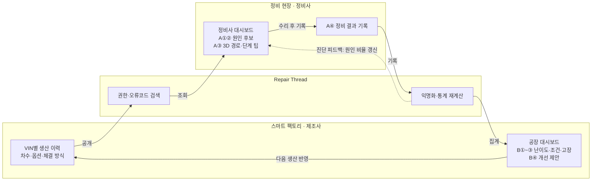
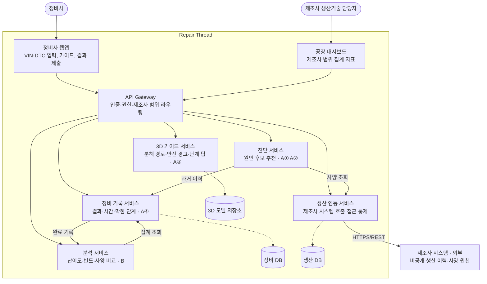
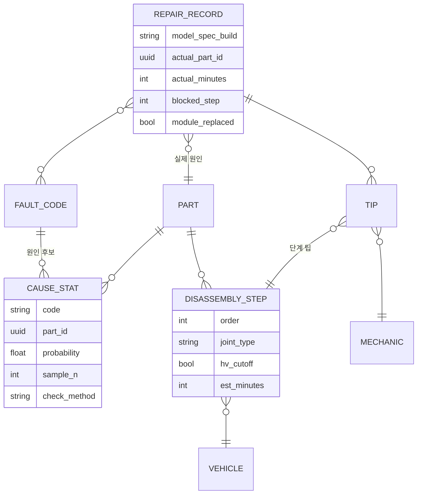
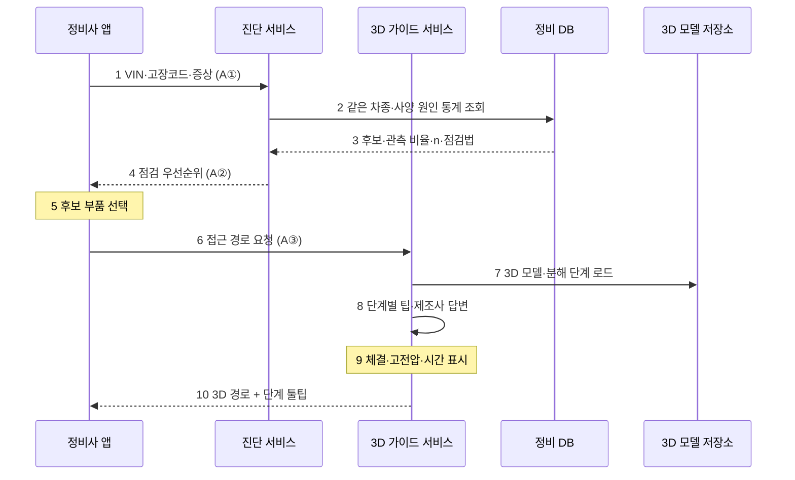
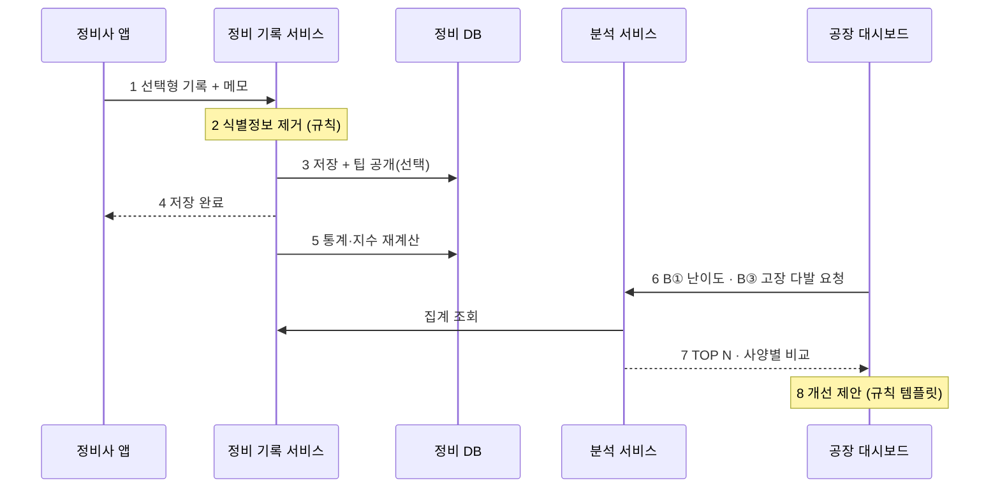
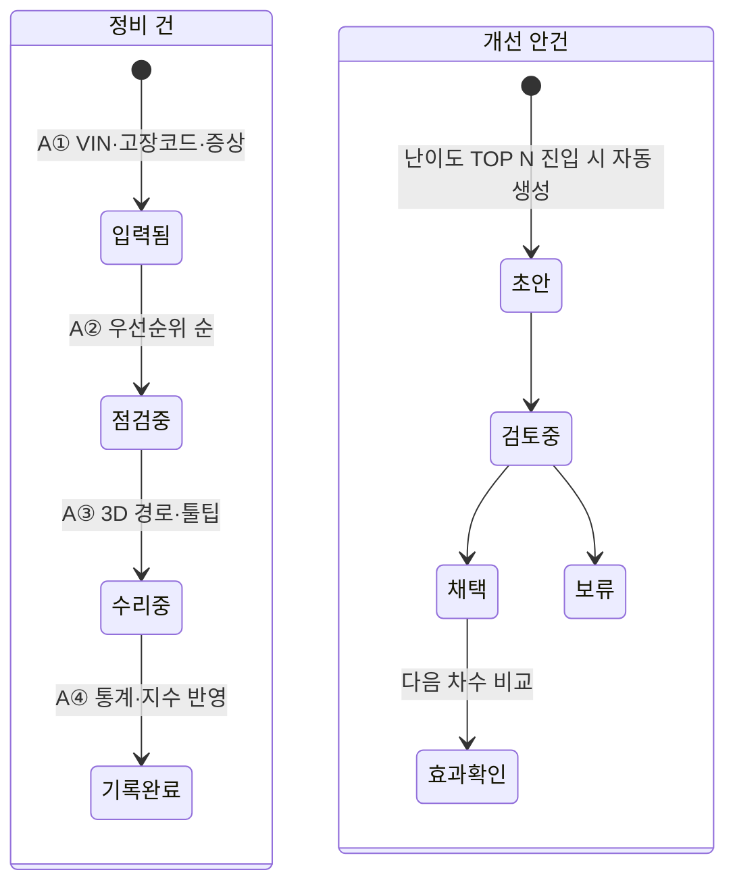

# 정비-공장 디지털 스레드 기획서 (5팀 팩토리)

2026-11-09 · 반정욱 (salieri009)

## 한 줄 요약

정비사가 3D로 돌려보고 눌러보는 **인터랙티브 해체 설명서**를 만듦. 부품마다 툴팁이 붙어 있고, 툴팁에는 제조사 공식 설명과 다른 정비사들이 남긴 팁이 추천순으로 쌓임(정비사들만의 Stack Overflow). 정비사는 작업하면서 툴팁의 팁을 보고 바로 고치고, 도움된 팁에 추천하거나 자기 팁을 남김. 부품별 조회·팁·원인 태그 데이터는 제조사로 돌아가 다음 설계·공정 개선에 쓰임.

- 가칭: 리페어 스레드 (Repair Thread), 3D 설명서 위의 정비사 Stack Overflow
- 메인 사용자: 독립 정비소 정비사 (팁을 보며 고치는 신입 · 팁을 남기는 숙련자) · 보조 사용자: 제조사 생산기술 담당 · 이해관계자: 차량 소유자
- 맥락: LG CNS AM Inspire CAMP 6기 해커톤, 5팀 팩토리 도메인 (2026-11-09 \~ 11-10)
- 이 문서에 담긴 기획 문서: 문제 정의서 · 근거 자료집 · 페르소나와 시나리오 · 벤치마킹 · 기능 정의서 · 서비스 흐름 · 화면 기획 · 정책 정의서 · 의사결정 로그 · 기대효과와 지표 · 리스크와 예상 Q&A · 개발용 다이어그램

**팀 결정 (2026-11-09 15시 30분)**: 정비사 우선. 질문을 쓰는 게시판이 아니라 **3D 인터랙션이 되는 설명서 + 부품 툴팁**이 중심이고, 정비사는 툴팁의 팁을 확인하며 바로 고침. 해체도는 제조사 제공 + 정비사 제공, 원인은 커뮤니티 태그, 신뢰는 추천 + 자격증·정비업 인증. 제조사 대시보드는 팩토리 연결고리로 핵심 유지.

**대시보드 스펙 확정 (15시 40분)**: 정비사 대시보드(입력 → 점검 우선순위 → 3D 접근 경로 → 결과 기록 → 신입 모드)와 공장·설계 담당자 대시보드(난이도 지표 → 사양·생산 조건 비교 → 고장 다발 분석 → 개선 제안) 두 화면으로 구성. 3D 설명서와 툴팁 팁은 정비사 대시보드 ③ 접근 경로 안에 들어감. 상세는 5. 기능 정의서.

**팀 보드 반영 (16시 56분)**: 팀 사업 개요의 서비스 명칭은 **"차량 고장코드 기반 3D 정비 지원 서비스"**. 시범 범위는 공식 자료를 확보할 수 있는 차량 사양 1종 + 대표 고장코드 1개. 설계는 단일 REST 백엔드(논리 모듈 4개) + 관계형 DB + 파일 저장소로 정리됐고, 점검 순서는 제조사 공식 진단 순서가 기본이며 정비 기록의 관측 원인 비율은 근거로 함께 보여줌. 정비사 팁 외에 **제조사 기술 문의·답변**이 단계에 붙음. 상세는 5장, 8-9, 12-6, 12-7.

## 1. 문제 정의서

정비사는 작업 전에 "이 차 한 대"의 실제 구조를 알 수 없고, 제조사는 자기 설계·공정이 만드는 정비 비용을 알 수 없음. 둘 사이 정보가 차종 단위로, 한 방향으로만 흐르기 때문임.

### 문제 한 줄

같은 차종이라도 옵션·생산 시기·생산 공장에 따라 구조와 체결 방식이 다른데, 정비 현장에는 이 차이가 차 한 대(VIN) 단위로 전달되지 않음.

### 문제 정의 문장 (팀 보드 템플릿)

조립 공정이 자동화·모듈화되며 설계가 조립 효율(DFA) 중심으로 최적화된 환경에서, 독립 정비사는 고장코드만으로 원인 부품과 접근 경로를 알 수 없어 점검 순서와 분해 경로를 경험에 의존해 판단하고 있다. 그 결과 정비 시간과 품질이 정비사의 경력에 따라 크게 달라지고 정비 신뢰도가 떨어지며, 제조사는 실제 원인 부품과 정비 난이도를 모른 채 같은 설계를 반복한다.

팀 보드 배경: 현직 정비사인 팀원 지인이 부품이 예상한 위치에 없거나 접근 방식이 달라 작업이 지연된 경험이 출발점.

### 발생 배경

- 완성차 공장은 자동화와 다차종 유연 생산으로 가면서 로봇이 조립하기 쉬운 구조로 설계·공정을 최적화함
- 볼트 대신 접착·용접, 작은 부품 대신 큰 모듈, 조립 순서도 로봇 기준
- 결과: 조립은 쉬워졌지만 정비는 어려워짐
- 업계 공통 문제이며, 기아 EVO Plant는 다차종 유연 생산을 전면에 내세운 대표 사례

팀 현장 관찰: 내연기관은 증상으로 원인을 바로 짚을 수 있지만 전기차는 그렇지 않아, 일부 서비스센터에서만 수리되고 동네 정비소는 손대기 어려움.

### 현재 해결 방식과 한계

| 현재 방식 | 한계 |
| --- | --- |
| 제조사 정비 매뉴얼 (기아 GSW 등) | 차종 단위 표준 자료. 차 한 대의 옵션·생산 이력 차이를 반영 못 함 |
| 매뉴얼 검색 | 정비사가 차종·연식·계통을 골라 직접 찾아 들어가야 함 |
| 정비 현장 경험 | 개인·정비소 안에만 남고 제조사로 돌아가지 않음 (일방향) |
| 제조사 생산 데이터 | 공정 노하우 보호, 책임, 보안 문제로 공장 밖으로 못 나감 |

### 페인 포인트

**정비사 (메인 사용자)**

- 볼트인 줄 알았던 부위가 접착이거나, 다른 부품을 여러 개 먼저 떼야 함
- 그래서 작업 시간과 견적 예측이 틀림
- 매뉴얼은 차종·연식·계통을 골라 직접 찾아야 함

**제조사 (보조 사용자)**

- 생산 데이터는 많지만 공장 밖으로 내보내기 어려움
- 조립 효율 지표는 있지만 정비 난이도 지표는 없음. 설계·공정이 정비 비용을 얼마나 만드는지 알 방법이 없음

**차량 소유자 (이해관계자)**

- 정비가 어떤 과정을 거치는지 보이지 않아 견적과 작업을 신뢰하기 어려움

### 원인 (팀 보드 정리)

1. **조립 효율과 정비 용이성의 충돌**: 로봇이 조립하기 좋은 구조(접착, 모듈화, 로봇 기준 조립 순서)는 사람이 분해하기 좋은 구조와 다름
2. **생산 데이터가 공장 밖으로 안 나옴**: 차 한 대 단위 조립 데이터는 있지만 노하우 보호·책임·보안 때문에 정비 현장에 전달되지 않음. 매뉴얼은 차종 단위
3. **정보 흐름이 일방향**: 어디서 막혔고 얼마나 걸렸는지가 제조사로 돌아가지 않아, 설계·공정이 정비 비용을 얼마나 만드는지 모름

팀 정리 한 줄: 본질은 DFA(조립 용이성 설계)와 DFS(정비 용이성 설계) 사이의 간극을 공정 단계에서 최적화하는 것.

### 파급 문제

| 파급 문제 | 누가 손해 보나 | 내용 |
| --- | --- | --- |
| 수리비·수리 기간 증가 | 소비자 | 부품 하나 때문에 모듈 전체 교체 |
| 보험료 상승·중고차 가치 하락 | 소비자, 보험사 | 특히 전기차에서 "수리가 비싸고 어렵다"는 인식 |
| 정비 품질·안전 문제 | 소비자, 정비사 | 구조를 모르고 잘못 분해하거나 재조립 불량 |
| 일반 정비소 경쟁력 약화 | 독립 정비소, 소비자 | 견적 오류·작업 지연 반복, 정보 격차로 직영망에만 정비 집중 |
| 플릿·PBV 운행 중단 | 법인 고객 | 정비 지연이 고객 사업 중단으로 이어짐 |
| 브랜드 평판 하락·설계 문제 반복 | 제조사 | 정비 불편이 쌓여 신뢰도 하락, 같은 설계 문제가 다음 차종에서도 반복 |

### 스마트 팩토리와의 연결성

원인이 스마트 팩토리에 있고, 해결도 스마트 팩토리 데이터로 함. 핵심은 데이터를 양방향으로 잇는 것.

| 방향 | 내용 |
| --- | --- |
| 공장 → 정비 현장 | VIN별 생산 이력을 바탕으로 그 차에 맞는 분해 순서, 체결 방식, 예상 작업 시간 제공 (권한 등급별 공개 범위 조절) |
| 정비 현장 → 공장 | 정비사의 실제 작업 기록(소요 시간, 막힌 부위, 모듈 교체 여부)을 모아 부품별 정비 난이도 지표를 만들고 다음 생산의 조립 순서·체결 방식 개선에 반영 |

두 번째 방향 덕분에 공장 안의 의사결정을 바꾸는 솔루션이 되고, 그래서 팩토리 도메인에 정확히 들어감. 업계에서는 설계-생산-정비 데이터 연결을 디지털 스레드라고 부름.

### 지금 vs 개선 (팀 보드)

| 지금 | 이렇게 개선 |
| --- | --- |
| 제조사에서 정비 현장으로 가는 단방향 소통만 존재 | 정비 현장 작업 기록이 공장으로 돌아오는 양방향 구조 |
| 정비 현장에서 제조사로 가는 피드백 채널 없음 | 정비 기록을 모아 부품별 정비 난이도 지표를 만들고 설계·공정 개선에 반영 |
| 실제 소요 시간·막힌 부위 경험이 개별 정비사·정비소에 머묾 | 작업 기록을 공통 형식으로 쌓아 다른 정비와 제조사 개선에 활용 |
| 공장 내부 조립 효율 중심 최적화 | 생산부터 정비까지 연결해 조립 효율과 정비 용이성을 함께 최적화 |
| 정비사가 차종·연식·계통을 골라 매뉴얼을 직접 찾음 | 차량과 작업 대상을 고르면 그 차에 맞는 정비 정보 제공 |

### 요구사항 (팀 보드)

| 사용자 | 지금 겪는 문제 | 요구사항 |
| --- | --- | --- |
| 정비사 | 수리 매뉴얼은 있지만 숙련도에 따라 실제 수리 실력 차이가 큼 | 3D로 돌려보는 친화적인 해체 설명서와 부품별 정비사 팁으로 전체 정비사 실력을 상향 평준화 |
| 차량 소유자 | 수리가 어떻게 진행되는지 몰라 비용 손해나 심리적 부담이 생김 | 실제 수리 과정을 고객이 직접 찾아볼 수 있어 안심 |
| 제조사 | 차량 오류코드만 받고 실제 원인 부품까지는 알 수 없음 | 오류코드 아래 실제 원인을 태그로 고르게 해서 제조사가 문제 부품을 파악 |

| 사용자 | 지금 겪는 문제 | 요구사항 |
| --- | --- | --- |
| 정비사 | 제조사 매뉴얼, 분해도, 다른 정비사 경험이 흩어져 있어 상황에 맞는 정보를 빨리 못 찾음 | 통합된 제조사 해체도를 UI로 바로 보여주고, 관련 과거 정비 사례를 이미지·해결 과정·결과로 제공 |
| 시스템 | 정비 이력·문제 상황이 메모 같은 비정형 데이터로 남음 | 비정형 정비 데이터를 구조화해서 저장 (실제 원인 부품, 소요 시간, 막힌 단계, 모듈 교체) |

위 2행은 팀 보드 요구사항 프레임에 15시 이후 추가된 항목.

### 현재 업무 흐름과 문제점 (팀 사업 개요)

지금 정비사의 일 순서:

1. 진단기로 고장코드를 확인하고, 차량 사양에 맞는 정비 매뉴얼과 부품 도면을 조회함
2. 매뉴얼과 실차를 대조해 점검 순서를 정하고, 필요하면 주변 부품을 탈거해 대상 부품에 접근함
3. 접근 방향이나 탈거 요령이 불명확하면 동료에게 묻고, 점검·수리 후 해결 여부를 확인함

| 문제점 | 개선 방향 | 대시보드 기능 |
| --- | --- | --- |
| 고장코드만으로 원인을 확정하기 어려워 낯선 차종에서 첫 점검 항목을 정하는 데 시간이 걸림 | 차량 사양·고장코드에 맞는 점검 항목을 추천 순서로 제시하고, 점검 이유와 결과별 후속 조치를 안내 | A① A② |
| 부품 위치를 알아도 주변 부품 배치와 선행 탈거 순서를 따로 파악해야 함 | 점검 항목을 고르면 3D 모델과 작업 순서를 함께 표시하고, 단계를 고르면 그 단계에서 탈거할 부품을 빨간색으로 강조 | A③ |
| 현장 요령이 개인 경험으로 남아 다른 정비사가 찾아보기 어려움 | 3D 작업 화면 아래에 해당 차량·단계의 팁을 표시. 제조사 공식 절차, 정비사 팁, 제조사 답변을 구분 | A③ A④ |
| 개별 문의만으로는 반복 교체 부품과 어려운 작업 단계를 파악하기 어려움 | 제조사 대시보드에서 차종·연식·고장코드별 완료 작업 수, 교체 부품 수, 해결 여부, 반복 의견을 확인 | B |

## 2. 리서치 근거 자료집

문제의 세 축(구조 변화, 정비 비용, 정보 일방향)은 모두 공개 자료로 뒷받침됨. 단, "자동화 구조 = 무조건 수리 불가"는 반례가 있어서, 우리 주장은 "정비 정보와 설계 피드백이 없으면 비용이 커진다"로 잡는 게 정확함.

### A. 다차종 유연 생산과 자동화 (기아 EVO Plant)

| 근거 | 출처 |
| --- | --- |
| 화성 EVO Plant는 기아가 PBV를 위해 지은 스마트팩토리로, 다차종 유연 생산·자동화 최적화·데이터 기반 품질관리를 내세움 | [HMG 스토리](https://www.hyundaimotorgroup.com/ko/story/kia-evo-plant-pbv-advanced-manufacturing-solutions) |
| PV5 패신저·카고 외에 샤시캡, 교통약자용 WAV 등 파생 모델을 한 공장에서 동시에 생산. 인근 컨버전 센터와 오픈베드·탑차·캠핑카까지 개발·생산 | [HMG 테크데이](https://www.hyundaimotorgroup.com/ko/story/kia-pbv-production-hub-tech-day) |
| East 차체공장은 4-벅 순차 조립 공법 적용 | [오토뷰](https://www.autoview.co.kr/ko-kr/articles/101684) |
| 차체 용접을 100% 자동화한 기아 첫 PBV 전용 공장 | [더구루 르포](https://www.theguru.co.kr/mobile/article.html?no=106846) |
| 모든 제조 데이터를 서버에 쌓아 품질 미달 차량 인도를 막는 체계 (기사 AI 요약 문구라 원문 재확인 필요) | [HMG 테크데이](https://www.hyundaimotorgroup.com/ko/story/kia-pbv-production-hub-tech-day) |

시사점: 같은 PV5라도 파생 모델 + 외부 컨버전까지 더해져 VIN마다 구조가 달라질 여지가 큼. 그리고 공장 안에는 이미 VIN별 제조 데이터가 쌓이고 있음.

### B. 구조 변화가 수리비·보험에 미치는 영향

| 근거 | 출처 | 신뢰도 |
| --- | --- | --- |
| 많은 EV는 사고 후 살짝 손상된 배터리 팩도 수리·진단할 방법이 없어 보험사가 저주행 차량을 전손 처리, 보험료 상승으로 이어짐 | [Reuters 인용, Fleet News](https://www.fleetnews.co.uk/news/manufacturer-news/2023/03/28/ev-insurance-set-to-rise-unless-car-makers-address-battery-repairs) | 높음 (2023) |
| 보험업계는 수리 쉬운 팩과 제3자의 배터리 셀 데이터 접근이 없으면 보험료가 계속 오를 것이라 경고 | [Insurance Business](https://www.insurancebusinessmag.com/uk/news/auto-motor/insurers-warn-they-need-better-access-to-ev-data-440310.aspx) | 높음 |
| Allianz는 셀이 멀쩡해 보이는 긁힌 팩도 진단 데이터가 없어 전손 처리한 사례가 있음 | [Wapcar](https://www.wapcar.my/news/66098ev-battery-scratched-during-accident-insurance-may-consider-it-a-total-loss-66098) | 중간 |
| Gartner 전망: 2027년까지 EV 차체·배터리 중대사고 평균 수리비 30% 증가 | [Notebookcheck](https://www.notebookcheck.net/Geico-blames-Cybertruck-repairability-for-insurance-cancellations-as-Progressive-denies-new-coverage.899330.0.html) | 중간 (2차 인용) |
| **반례**: Thatcham 연구에서 Model Y 리어 기가캐스팅 부분 수리가 Model 3 다부품 차체보다 약 2,932달러 저렴 | [Drive Tesla](https://driveteslacanada.ca/news/study-finds-tesla-gigacastings-lower-vehicle-repair-costs/) | 높음 |
| **반례의 조건**: 설계 단계에서 수리성을 고려하면 생산·수리 모두 이점. Thatcham 연구는 Tesla가 승인망 밖에 부품과 수리 매뉴얼을 공개해서 가능했음 | [Drive Tesla](https://driveteslacanada.ca/news/study-finds-tesla-gigacastings-lower-vehicle-repair-costs/), [UKi Media](https://www.ukimediaevents.com/publication/cdfa8bf9/54) | 높음 |

시사점: 반례가 오히려 우리 논리를 강화함. 수리 비용을 가르는 건 "자동화 여부"가 아니라 "설계 단계의 수리성 반영 + 정비 정보 공개"임.

### C. 정비 정보 접근권 (국내)

| 근거 | 출처 |
| --- | --- |
| 국토부 규정상 제작자는 신차 판매 후 6개월 이내에 정비매뉴얼과 고장진단기를 직영과 동일하게 일반 정비업자에게 제공해야 함 (규정 제정 시점은 원문 재확인 필요) | [비즈한국](https://bizhankook.com/articles/10405.html) |
| 자동차관리법상 제작자의 정비기술정보 제공 의무는 있지만 제공 범위가 불명확하고, 제작자는 협력정비업체에만 차별 제공할 유인이 있다는 지적 | [보험연구원 KiRi Weekly 2013](https://www.kiri.or.kr/report/downloadFile.do?docId=6667) |
| 정비업자는 점검·정비명세서 발급 후 72시간 이내에 정비 이력을 전산 전송할 의무, 미전송 시 건당 10만원 과태료 | [국토교통부 정책Q&A](https://www.molit.go.kr/USR/policyTarget/dtl.jsp?idx=591) |
| 직영서비스센터 일감 쏠림 문제로 중소 정비업체 이용 권유를 허용하는 개정안 발의 (2024) | [국민참여입법센터](https://opinion.lawmaking.go.kr/gcom/nsmLmSts/out/2201437/detailRP) |

시사점: 매뉴얼 "제공 의무"는 이미 있음. 빈칸은 **VIN 단위 as-built 정보**와 **정비 → 제조사 피드백**. 그리고 정비 이력 전산 전송 의무가 있다는 건 정비 기록을 구조화할 제도적 기반이 이미 있다는 뜻.

### D. 해외 정비 정보 접근권과 데이터 공유

| 근거 | 출처 |
| --- | --- |
| 미국 독립 정비소는 월 최대 5대를 딜러로 넘긴다는 ACA 조사 | [FleetMaintenance](https://www.fleetmaintenance.com/equipment/government-and-regulations/article/55384908/right-to-repair-independent-shops-access-to-repair-data) |
| 2026년 미 하원 통과 법안이 2014년 제조사-독립정비업계 정비정보 접근 MOU를 명문화 | [Dealership Guy](https://news.dealershipguy.com/p/trump-signals-support-for-right-to-repair-as-debate-over-vehicle-service-access-intensifies) |
| 제조사 반대 논리: 데이터 개방은 사이버보안 위험 | [The Drive](https://thedrive.com/news/why-drivers-and-mechanics-are-united-against-automakers-right-to-repair-explained) |
| EU 배터리 패스포트: 2027-02-18부터 EV 배터리 등에 QR 기반 디지털 기록 의무, 인증 정비업체에 표준 정비 이력 제공 목표 | [Sibros](https://www.sibros.tech/post/navigating-the-eu-battery-passport-what-oems-need-to-know-before-2027), [Messe Frankfurt](https://automotive.messefrankfurt.com/global/en/news-insights/industry-insights/european-battery-passport.html) |

### E. 생산 이력 ↔ 현장 고장 연결 (보증 분석·디지털 스레드)

| 근거 | 출처 |
| --- | --- |
| 보증 분석의 핵심 가치는 클레임을 정확한 차량 구성·생산 조건·공급 출처에 연결하는 데서 나옴 | [Umbrex](https://umbrex.com/resources/umbrex-explainers/automotive-mobility-explainers/warranty-analytics-in-automotive/) |
| 공장에 데이터가 이미 있어도 서로 다른 시스템에 흩어져 연결이 안 됨 | [iFactory](https://ifactoryapp.com/industries/automotive-manufacturing/warranty-prevention-closed-loop-production-inspection) |
| Catena-X Quality KIT: OEM 현장 품질 데이터와 협력사 제품 정보를 합쳐 조기 고장 탐지·원인 분석 | [Eclipse Tractus-X](https://eclipse-tractusx.github.io/docs-kits/kits/data-driven-quality-management-kit/adoption-view) |
| 디지털 스레드의 핵심 요소 중 하나는 양방향 흐름: 제조·서비스 피드백이 다음 설계로 돌아감 | [Leo AI](https://www.getleo.ai/blog/digital-thread-manufacturing-explainer) |
| 서비스 기술자가 정확한 as-built 정보가 없어 수리 시간이 늘어나는 것이 디지털 스레드가 푸는 문제로 명시됨 | [Siemens 블로그](https://blogs.sw.siemens.com/industrial-machinery/?p=826) |
| 수리성 설계 가이드(RCAR Design for Repair)는 업계 표준 참고 자료로 존재 | [RCAR](https://www.rcar.org/_files/ugd/7822f6_0ee76483ab1148f2b5b2c3ef727a6bfc.pdf) |
| GM은 1978년부터 교체성·수리성·접근성·진단성 등 8개 영역을 서비스성 설계 기준으로 다룸 | [SAE 780279](https://saemobilus-test.cld.sae.org/papers/serviceability-a-design-discipline-780279) |

시사점: "정비 난이도를 설계 지표로 쓰자"는 발상 자체는 오래됐음. 새로운 건 **VIN 단위 생산 데이터와 정비 현장 기록을 자동으로 이어서 지표를 매번 갱신**하는 부분임.

### F. 설계 단계에서 조립성과 정비성을 함께 검증한 사례 (팀 보드 BMW 사례 검증)

| 근거 | 출처 | 상태 |
| --- | --- | --- |
| BMW AG 연구진이 1998년 VR 가상 프로토타이핑으로 조립·정비 프로세스를 검증하는 방법을 발표 | [ASME DETC 1998, BMW AG](https://user.informatik.uni-bremen.de/~zach/papers/asme98.pdf) | 확인됨 |
| BMW는 VR로 신형 3시리즈 생산 작업장을 실제 크기 시험 설치 없이 설계 | [BMW PressClub 2018](https://www.press.bmwgroup.com/global/article/detail/T0287223EN/a-glimpse-of-the-future-bmw-group-uses-virtual-reality-to-design-future-production-workstations) | 확인됨 (조립 쪽 사례) |
| 팀 보드의 "헤드램프 전구 교체에 범퍼 전체 탈거 → 생산·서비스 엔지니어가 VR에서 볼트 위치 합의" 세부 사례 | 출처 못 찾음 | 발표 사용 보류 |

시사점: "설계 단계에서 DFA와 DFS를 같이 본다"는 방향 자체는 BMW가 오래전부터 해온 일. 우리 차별점은 VR 검증이 아니라 **출고 후 실제 정비 현장 데이터**로 그 판단을 계속 보정한다는 점.

### G. 숙련도 차이와 고장코드 한계 (팀 근거 자료)

| 근거 | 내용 | 상태 |
| --- | --- | --- |
| Lancaster & Kolodner (1987) | 자동차 정비 교육생 연구에서 경험 수준에 따라 증상에서 원인 후보를 좁히고 점검 순서를 정하는 방식이 다르게 관찰됨 | 팀 자료, 원문 확인 필요 |
| Abele & von Davier (2019), Meier 외 (2022) 재인용 | 3년 직업훈련 종료 시점에 복잡한 고장 진단 전략을 숙달한 훈련생이 약 15% | 팀 자료, 재인용이라 원문 확인 필요 |
| Honda 기술 공지 (2021) | 같은 실화 코드(P0300 등)의 원인 후보로 점화코일, 점화플러그, 연료 인젝터, 흡기밸브 카본 축적을 제시 | 팀 자료, 원문 확인 필요 |
| Zafar 외 (2026, 사전공개) | 대형 트럭 제조사 데이터 885건에서 고장코드만 쓴 모델의 엔진 고장 분류 정확도 최고 58.0%, 증상 설명을 함께 쓰면 68.8% | 사전공개 논문, 발표 시 "사전공개" 명시 |

시사점: "고장코드만으로는 원인이 특정되지 않는다"와 "경력에 따라 진단 방식이 다르다"를 숫자로 받칠 수 있음. A①에서 증상을 같이 받는 이유(58.0% → 68.8%)와 A⑤ 신입 모드의 근거가 됨.

## 3. 페르소나와 As-is / To-be 시나리오

Stack Overflow처럼 "보는 사람"과 "남기는 사람"이 있어야 굴러가서, 정비사를 신입(팁을 보며 고치는 사람)과 숙련자(팁을 남기는 사람) 둘로 나눔. 보조는 제조사 생산기술 엔지니어. 모두 가상 인물이고 차량도 가상 차량 "PBV-X"로 둠.

### 페르소나

| 구분 | 메인 A: 신입 정비사 "김 주임" (가상) | 메인 B: 숙련 정비사 "박 실장" (가상) | 보조: 생산기술 "이 책임" (가상) |
| --- | --- | --- | --- |
| 소속 | 경기도 독립 종합정비업체 | 경기도 독립 종합정비업체 대표 | 완성차 제조사 PBV 공장 생산기술팀 |
| 경력 | 정비 2년, EV·PBV 경험 거의 없음 | 정비 20년, 정비업 등록·자격증 보유 | 차체·조립 공정 설계 8년 |
| 역할 | 3D 설명서와 팁을 보며 고치는 사람 | 부품에 팁을 남기는 사람 | 조회·팁 데이터를 보는 사람 |
| 목표 | 처음 보는 구조도 혼자 해결, 재작업 없음 | 견적이 틀리지 않음, 업계 평판 | 조립 효율을 지키며 품질·고객 불만 줄이기 |
| 페인 | 고장코드는 영역만 알려줘서 어디부터 볼지 모름. 매뉴얼은 글 위주라 실제 위치가 안 그려짐 | 같은 요령을 후배·지인에게 반복해서 설명. 노하우가 어디에도 남지 않음 | 정비 현장에서 무슨 일이 생기는지 모름. 오류코드의 실제 원인 부품을 모름 |
| 쓰는 도구 | 제조사 매뉴얼, 고장진단기, 유튜브·카페 검색 | 제조사 매뉴얼, 고장진단기, 지인 단톡방 | MES, 품질 DB, 공정 설계 도구 |
| 참여 조건 | 작업 중 한 손으로도 돌려보고 누를 수 있음 | 팁이 추천·배지로 평판이 됨 | 공정 노하우 노출 없음, 책임 소재 명확 |

### 시나리오: PBV-X 카고 후방 경미 충돌, 리어 도어 주변 수리

**As-is (지금)**

1. 고객 차 입고. 박 실장이 매뉴얼에서 차종·연식·계통을 골라 리어 도어 탈거 절차를 찾음
2. 매뉴얼 기준 볼트 체결로 보고 2시간 견적
3. 열어보니 이 차는 해당 브래킷이 접착 체결 (생산 시기·사양 차이). 인접 패널을 먼저 떼야 함
4. 작업 5시간으로 늘어남. 견적 재협상, 고객 불만, 부품 추가 주문으로 출고 지연
5. 박 실장의 경험은 정비소 안에만 남음. 제조사는 이 일이 있었는지 모름

**To-be (리페어 스레드)**

1. 김 주임이 VIN 입력 → PBV-X, 카고 사양, 2026년 2분기 생산, 화성 공장이 자동 표시. 진단기에서 읽은 고장코드 2개와 증상 "경고등" 입력 (A①)
2. 점검 우선순위: "이 사양에서 이 코드의 62%는 리어 도어 브래킷 커넥터 불량 (n=48)" 1순위, 점검 방법은 육안 + 저항값 기준 (A②)
3. 1순위 선택 → 3D에서 리어 도어 브래킷까지 분해 단계 6개 재생. 단계마다 체결 방식, 고전압 차단 불필요 표시, 예상 45분 (A③)
4. 4단계 툴팁에 공식 설명 + "이 차수는 접착 체결, 인접 패널 먼저"(박 실장, 정비업 인증, 추천 37). 신입 모드라 체크리스트로 따라감 (A③ A⑤)
5. 작업 후 결과 기록: 실제 원인 = 커넥터, 52분, 막힌 단계 4, 모듈 교체 안 함, 메모는 팁으로 공개 (A④)
6. 기록이 쌓여 A②의 62%가 갱신되고, 고객은 공유 링크로 3D 단계와 사진을 확인 (Should)
7. 이 책임은 공장 대시보드에서 "리어 도어 브래킷: 카고 사양만 표준 대비 2배, 막힌 단계 4 집중"(B① B②)을 보고 체결 방식 변경 검토 제안(B④)을 안건으로 올림

**바뀌는 것 한 줄**: 김 주임은 질문 없이 3D와 팁만 보고 고치고, 박 실장의 노하우는 부품 위에 평판으로 남고, 이 책임은 처음으로 정비 현장의 막힘을 설계 지표로 봄.

## 4. 벤치마킹 분석

기존 방식은 "차종 단위 + 공장→정비 일방향"이거나, "개별 단위"여도 배터리·보증 클레임처럼 범위가 좁음. VIN 단위 구조 정보를 정비 현장에 주고, 보증 밖 독립 정비소 기록을 공장 공정 지표로 되돌리는 조합은 공개 자료상 보이지 않음.

| 기존 방식 | 데이터 방향 | 정보 단위 | 한계 (우리 기회) |
| --- | --- | --- | --- |
| 제조사 정비 매뉴얼 (기아 GSW 등) | 공장 → 정비 | 차종·연식 | 차 한 대의 생산 이력 차이 미반영, 피드백 없음 |
| [국토부 정비자료 제공 규정](https://bizhankook.com/articles/10405.html) | 공장 → 정비 | 차종 | 직영과 동일 제공 의무지만 as-built 정보는 범위 밖 |
| [Tesla 부품·수리 매뉴얼 외부 공개 + Thatcham 연구](https://driveteslacanada.ca/news/study-finds-tesla-gigacastings-lower-vehicle-repair-costs/) | 공장 → 정비 → 보험 연구 | 차종·부위 | 공개가 수리비 검증과 설계 개선 논의로 이어진 사례. 단, 상시 데이터 루프는 아님 |
| [EU 배터리 패스포트](https://www.sibros.tech/post/navigating-the-eu-battery-passport-what-oems-need-to-know-before-2027) | 공장 → 정비·재활용 | 배터리 개체 (QR) | 개체 단위라는 점은 같음. 배터리 한정, 규제 준수 목적, 설계 피드백 아님 |
| [Catena-X Quality KIT](https://eclipse-tractusx.github.io/docs-kits/kits/data-driven-quality-management-kit/adoption-view) | OEM ↔ 협력사 | 부품·현장 품질 | 양방향이지만 B2B 품질 분석. 정비사가 참여하지 않음 |
| [보증 분석 솔루션](https://umbrex.com/resources/umbrex-explainers/automotive-mobility-explainers/warranty-analytics-in-automotive/) | 정비(보증 클레임) → 공장 | VIN·로트 | 보증 기간 안 직영 클레임 중심. "고장"은 보지만 "정비 난이도"는 안 봄 |
| [정비 이력 전산 전송 의무](https://www.molit.go.kr/USR/policyTarget/dtl.jsp?idx=591) | 정비 → 정부 시스템 | VIN | 이력만 쌓이고 구조 정보·제조사 피드백으로 안 이어짐 |

### 우리 포지션

- **단위**: 배터리 패스포트처럼 개체(VIN) 단위
- **방향**: Catena-X처럼 양방향
- **누가 데이터를 만드나**: 보증 분석과 달리 보증 밖 독립 정비소까지
- **무엇을 재나**: 고장이 아니라 정비 난이도 (시간, 막힌 부위, 모듈 교체)
- **어디에 쓰나**: 매뉴얼 개선이 아니라 다음 생산의 공정·체결 방식 결정

### 팀 보드의 차별점과 보정

| 팀 보드 차별점 | 보정 (발표용 표현) |
| --- | --- |
| 전기차·내연기관, 제조사 상관없이 모든 차종의 분해도 보유 → 정비사 전체 수준 향상 | 해커톤은 가상 차량 1종으로 시연. 실서비스는 제조사 데이터 제휴가 전제이며, "보유"가 아니라 "연결"로 표현 |
| 정비받는 사용자가 어떤 과정을 거치는지 확인해 신뢰를 가짐 | 차량 소유자에게 해체 과정 화면 공유 (Should 기능) |
| 제조사별 웹 매뉴얼의 텍스트 설명을 이미지로 더 친절하게 | 기능 1 해체도 단계별 이미지. 원문 매뉴얼 재배포가 아니라 이 차 기준 단계 재구성으로 표현 |
| 부품 해체도를 보여주니 전기차도 동네 정비소에서 수리 가능 | 고전압 작업은 별도 자격·안전 절차가 필요하므로 "수리 가능 범위를 넓힌다"로 완화 |

### Stack Overflow 구조 대응

| Stack Overflow | 리페어 스레드 | 비고 |
| --- | --- | --- |
| 질문 | 3D 설명서의 부품 그 자체 | 질문을 쓰지 않음. 부품을 누르는 게 곧 "이거 어떻게 빼지?" |
| 답변 · 추천 | 부품 툴팁의 정비사 팁 · 도움됐어요 | 팁이 추천 + 인증 배지순으로 정렬 |
| 채택된 답 | 툴팁 상위 3개 팁 | 공식 설명은 맨 위 고정 |
| 공식 문서 | 제조사 공식 설명·3D 모델 | 정비사 제공 사진과 출처 구분 |
| 태그 | 차종 · 오류코드 · 원인 · 부품 4종 태그 | 원인 태그는 커뮤니티가 붙임 |
| 평판 · 배지 | 추천 점수 + 자격증·정비업 인증 배지 | 사람 추천과 공식 인증을 같이 씀 |
| 검색 | 오류코드 → 3D 부품 하이라이트 (기능 3) | 글 목록이 아니라 3D 위치로 안내 |
| (없음) | 제조사 인사이트 대시보드 (기능 2) | 커뮤니티 데이터가 공장으로 돌아가는 부분. 팩토리 연결고리 |

## 5. 기능 정의서

기능은 대시보드 두 개로 정리함: 메인 사용자인 정비사 대시보드(A)와 공장·설계 담당자 대시보드(B). 정비사가 A④에 남긴 결과가 A② 원인 확률과 B 지표를 동시에 키우는 게 피드백 루프의 핵심. 3D 설명서·툴팁 팁(이전 기능 1)은 A③에, 오류코드 검색(이전 기능 3)은 A①②에, 제조사 대시보드(이전 기능 2)는 B에 들어감 (의사결정 로그 D18).

### A. 정비사 대시보드 (메인 사용자)

| # | 기능 | 우선 | 내용 |
| --- | --- | --- | --- |
| A① | 차량·고장코드 입력 | 필수 | VIN 입력 → 차종·사양·생산 시기·생산 공장 자동 표시 · 진단기에서 읽은 고장코드 입력(여러 개 동시) · 증상 선택(경고등, 소음, 출력 저하 등) |
| A② | 점검 우선순위 추천 | 필수 | 제조사 공식 진단 순서를 기본으로 원인 후보 부품을 표시하고, 기록이 쌓이면 관측 원인 비율을 근거로 함께 표시(필수 공식 선행 순서는 유지) · 같은 차종·사양 기준 통계임을 표본 수와 함께 표시 (예: "이 사양에서 이 코드의 62%는 커넥터 불량, n=48") · 후보마다 점검 방법(육안 점검, 측정값 기준 등) |
| A③ | 부품 접근 경로 (3D 설명서 + 단계 툴팁) | 필수 | 선택한 부품까지 분해 순서를 단계별로 3D로 재생 · 단계마다 체결 방식(볼트·클립·접착·모듈 교체) 표시 · 전기차는 고전압 차단 필요 여부 경고 · 예상 작업 시간 · 단계를 누르면 그 단계에서 탈거할 부품을 3D에서 빨간색으로 강조 · 단계 아래에 제조사 공식 절차, 정비사 팁(사진), 제조사 답변을 구분해 표시 |
| A④ | 정비 결과 기록 (피드백 루프 시작점) | 필수 | 실제 원인 부품 선택(추천 목록 중 / 기타) · 실제 소요 시간, 막혔던 단계, 모듈 통째 교체 여부 · 간단한 메모(공개 선택 시 해당 단계의 팁으로 등록) |
| A⑤ | 신입 모드 | 선택 | A③을 단계별 체크리스트로 안내하고 주의사항 강조. "정비 품질 균일화" 메시지를 데모로 보여주기 좋은 기능 |

### B. 공장·설계 담당자 대시보드

| # | 기능 | 우선 | 내용 |
| --- | --- | --- | --- |
| B① | 정비 난이도 지표 | 필수 | 부품별 평균 정비 시간, 표준 작업 시간 대비 초과율 · 정비 난이도 상위 부품 TOP N · 모듈 통째 교체 비율 |
| B② | 사양·생산 조건별 비교 | 필수 | 같은 부품이라도 사양, 생산 시기, 생산 라인에 따라 정비 시간이 어떻게 다른지 비교 (예: "같은 부품인데 특정 사양에서 정비 시간 2배" → 원인이 되는 조립 구조를 찾는 단서) |
| B③ | 고장 다발 분석 | 필수 | 고장코드별 실제 원인 분포 · 특정 사양·생산 시기에 고장이 몰리는지 탐지 → 품질 문제 조기 신호 |
| B④ | 공정·설계 개선 제안 | 선택 | 난이도 높은 부품에 "체결 방식 변경 검토", "조립 순서 조정 검토" 같은 제안 표시 · 개선 전후 정비 시간 비교 (데모에서는 가상 데이터로 시뮬레이션) |

### C. (확장) 정비소 관리자 대시보드 · 발표에서만 언급

- 정비사별 진단 시간, 재정비율 비교 → 교육이 필요한 영역 파악
- 경력자와 신입 간 품질 격차 추이

### MVP 구현 순서 (시간이 부족하면 이 순서로)

| 순서 | 범위 | 의미 |
| --- | --- | --- |
| 1 | 정비사 A① A② A③ | 핵심 가치: 진단 + 접근 경로 |
| 2 | 정비사 A④ + 공장 B① | 피드백 루프. 스마트 팩토리 연결의 증거 |
| 3 | 공장 B② B③ | 분석 깊이 |
| 4 | A⑤ 신입 모드, B④ 개선 제안, 툴팁 팁 추천·인증 배지, 고객 공유 링크 | 선택 기능 |
| 제외 | 질문 게시판, AI 자동 답변, 실제 제조사 CAD·MES 연동, 전 차종 3D, AR, 실제 자격 진위 확인, C 정비소 관리자 대시보드 구현 | 발표에서 확장 방향으로만 언급 |

### 실제 구현 / Mock / 미구현

| 실제 구현 | Mock | 미구현 (발표에서 명시) |
| --- | --- | --- |
| A①\~④ 화면과 API, 원인 후보 확률 계산(기록 집계), 웹 3D 뷰어(예: three.js, 팀 확정 필요)와 단계 툴팁, 고전압 경고 규칙, 결과 기록 구조화 저장, B① 지표 계산, B② B③ 집계 | 가상 차량 PBV-X 대표 사양 1종 + 대표 고장코드 1개 중심(B② 비교용으로 사양 3종·생산 시기 3구간·라인 2개, VIN 50대, 보조 고장코드 9개), 원인 후보 통계용 과거 정비 기록 300건(특정 사양·코드에 원인 집중 패턴 포함), 리어 도어 주변 저폴리 3D 모델(부품 10개 내외)·분해 단계 6개, 공식 설명·팁 120건, B④ 개선 전후 가상 데이터 | 실제 제조사 CAD·생산 데이터, 진단기 자동 연동(수기 입력으로 대체), 전 차종 모델, AR, 실제 자격 확인, C 대시보드 |

### 유스케이스 (User Story)

요구사항을 "As a 누구, I want to 무엇, So that 왜" 형식으로 풀어 기능과 MVP 순서에 연결함. MVP 열의 숫자는 위 구현 순서.

**As a 정비사**

| ID | As a | I want to | So that | 기능 | MVP |
| --- | --- | --- | --- | --- | --- |
| UC-M01 | 정비사 | VIN만 입력하면 차종·사양·생산 시기·생산 공장을 자동으로 보고 싶다 | 이 차가 같은 차종 표준과 어떻게 다른지 작업 전에 알기 위해 | A① | 1 |
| UC-M02 | 정비사 | 진단기 고장코드 여러 개와 증상을 한 번에 입력하고 싶다 | 복합 고장을 한 화면에서 진단하기 위해 | A① | 1 |
| UC-M03 | 정비사 | 원인 후보 부품을 고장 다발 확률 순으로 보고 싶다 | 경험이 적어도 어디부터 점검할지 정할 수 있게 | A② | 1 |
| UC-M04 | 정비사 | 그 확률이 몇 건 기준 통계인지 보고 싶다 | 추천을 얼마나 믿을지 스스로 판단하기 위해 | A② | 1 |
| UC-M05 | 정비사 | 후보마다 점검 방법(육안, 측정값 기준)을 보고 싶다 | 맞는 방법으로 빨리 확인하기 위해 | A② | 1 |
| UC-M06 | 정비사 | 선택한 부품까지 분해 순서를 3D로 돌려보고 싶다 | 작업 전에 접근 경로와 작업 시간을 예측해 견적을 맞히기 위해 | A③ | 1 |
| UC-M07 | 정비사 | 단계마다 체결 방식(볼트·클립·접착·모듈)을 보고 싶다 | 볼트인 줄 알았던 접착 부위에서 막히지 않기 위해 | A③ | 1 |
| UC-M08 | 전기차 정비사 | 고전압 차단이 필요한 단계에서 경고를 받고 싶다 | 감전 사고를 막기 위해 | A③ | 1 |
| UC-M09 | 정비사 | 막힌 부품·단계에서 다른 정비사 팁과 과거 정비 사례를 보고 싶다 | 누구에게 묻지 않고 그 자리에서 해결하기 위해 | A③ 툴팁 | 1 (추천·배지는 4) |
| UC-M10 | 정비사 | 작업 후 실제 원인·소요 시간·막힌 단계·모듈 교체 여부를 1분 안에 기록하고 싶다 | 다음 정비사의 원인 추천이 더 정확해지게 | A④ | 2 |
| UC-M11 | 숙련 정비사 | 내 요령을 팁으로 공개하고 추천·인증 배지로 인정받고 싶다 | 노하우가 평판으로 남게 | A④ 팁 | 4 |
| UC-M12 | 신입 정비사 | 단계별 체크리스트와 주의사항으로 안내받고 싶다 | 경력과 상관없이 같은 품질로 정비하기 위해 | A⑤ | 4 |
| UC-M13 | 정비사 | 고객에게 수리 과정을 링크로 보여주고 싶다 | 견적과 작업을 신뢰받기 위해 | 공유 링크 | 4 |

**As a 제조사 (공장·설계 담당자)**

| ID | As a | I want to | So that | 기능 | MVP |
| --- | --- | --- | --- | --- | --- |
| UC-F01 | 생산기술 담당 | 부품별 평균 정비 시간과 표준 대비 초과율을 보고 싶다 | 정비하기 어려운 부품을 숫자로 파악하기 위해 | B① | 2 |
| UC-F02 | 생산기술 담당 | 정비 난이도 TOP N과 모듈 통째 교체 비율을 보고 싶다 | 개선 우선순위를 정하기 위해 | B① | 2 |
| UC-F03 | 설계 담당 | 같은 부품의 정비 시간을 사양·생산 시기·생산 라인별로 비교하고 싶다 | 정비 시간을 늘리는 조립 구조의 단서를 찾기 위해 | B② | 3 |
| UC-F04 | 품질 담당 | 고장코드별 실제 원인 부품 분포를 보고 싶다 | 오류코드만으로는 몰랐던 원인 부품을 파악하기 위해 | B③ | 3 |
| UC-F05 | 품질 담당 | 특정 사양·생산 시기에 고장이 몰리면 신호를 받고 싶다 | 품질 문제를 조기에 잡기 위해 | B③ | 3 |
| UC-F06 | 설계 담당 | 난이도 높은 부품에 대한 개선 제안과 개선 전후 정비 시간 비교를 보고 싶다 | 체결 방식·조립 순서 변경 검토의 근거를 만들기 위해 | B④ | 4 |
| UC-F07 | 제조사 | 정비 현장 데이터를 정비소·정비사를 식별하지 않은 집계로 받고 싶다 | 개인정보·책임 문제 없이 데이터를 쓰기 위해 | 정책 8-2 | 2 |
| UC-F08 | 제조사 | 정비사에게 여는 정보를 등급별로 통제하고 싶다 | 공정 노하우 유출 없이 정비 정보를 공개하기 위해 | 정책 8-1 | 2 |

## 6. 서비스 흐름과 루프

루프는 정비사가 3D 설명서에서 부품을 누르는 순간 시작되고, 그 조회·추천·팁이 툴팁과 제조사 지표로 동시에 남을 때 닫힘.



윗줄은 제조사 3D 모델·공식 설명과 생산 사양이 정비사의 3D 설명서로 오는 흐름, 아랫줄은 정비사의 추천·팁·원인 태그가 익명 집계돼 제조사 대시보드로 가는 흐름. 새로 남긴 팁은 추천이 쌓이면 툴팁 상위로 올라가 다음 정비사가 바로 봄.

### 반복 사용 이유

- 신입 정비사: 처음 보는 구조를 만날 때마다 3D 설명서를 열고 툴팁을 봄
- 숙련 정비사: 남긴 팁이 추천·배지로 쌓여 평판이 됨
- 제조사: 생산 차수가 바뀔 때마다 조회·팁 많은 부품과 오류코드별 실제 원인을 비교함
- 데이터: 팁이 쌓일수록 툴팁이 촘촘해지고, 같은 부위에서 막히는 시간이 줄어듦 (작은 내부 루프)

### 데모에서 루프가 보이는 순간

1. VIN·고장코드 입력 → 차량 정보 자동 표시 (A①)
2. 원인 후보가 확률 순으로 뜸, 표본 수 표시 (A②)
3. 1순위 부품까지 3D 분해 경로 재생, 단계 툴팁 (A③)
4. 결과 기록 제출 → A②의 확률이 바뀌는 장면 (A④)
5. 공장 대시보드에서 해당 부품이 난이도 TOP N에 올라오고 사양별 비교가 갱신됨 (B① B②)

## 7. 화면 기획 (스토리보드)

화면은 정비사 대시보드 4장 + 신입 모드 오버레이, 공장 대시보드 4장, 고객 1장(Should). 정비사 화면은 작업 중 한 손 조작을 전제로 큰 버튼.

### 정비사 화면 (모바일·태블릿)

| 화면 | 주요 요소 | 상태와 예외 |
| --- | --- | --- |
| M1 차량·고장코드 입력 (A①) | VIN 입력·QR, 자동 표시 카드(차종·사양·생산 시기·생산 공장), 고장코드 다중 입력 칩, 증상 선택 버튼 | VIN 오류 → "17자리 확인". 데이터 없는 VIN은 차종 표준 정보만 |
| M2 점검 우선순위 (A②) | 고장코드별 원인 후보 부품 순위(확률 막대), "같은 차종·사양 기준, n건" 라벨, 후보별 점검 방법(육안·측정값 기준) | 표본 30건 미만은 "참고용" 표시 (정책 8-8) |
| M3 3D 접근 경로 (A③) | 3D 뷰(회전·확대), 분해 단계 재생 바, 단계별 체결 방식 색, 고전압 차단 경고 배너, 예상 작업 시간, 부품·단계 툴팁(공식 설명 + 정비사 팁 + 관련 과거 사례) | 저사양 기기는 단계별 2D 이미지로 대체. 고전압 단계는 확인 체크 전 다음 단계 잠금 |
| M3+ 신입 모드 (A⑤) | M3 위에 단계별 체크리스트, 주의사항 강조 박스 | 체크 안 한 단계가 있으면 기록 화면으로 못 넘어감 |
| M4 정비 결과 기록 (A④) | 실제 원인 부품(추천 목록 / 기타), 실제 소요 시간, 막혔던 단계 선택, 모듈 통째 교체 여부, 메모 + "팁으로 공개" 토글 | 1분 안에 끝나도록 선택형 위주. 제출 후 "A② 통계에 반영됨" 피드백 |
| C1 고객 수리 과정 공유 (Should) | 정비사가 보낸 링크로 3D 단계·작업 사진 열람 | 정비소 연락처 외 개인정보 비노출 |

### 공장 화면 (웹 대시보드)

| 화면 | 주요 요소 | 상태와 예외 |
| --- | --- | --- |
| F1 정비 난이도 지표 (B①) | 부품별 평균 정비 시간, 표준 대비 초과율, 난이도 TOP N, 모듈 통째 교체 비율 | 기록 10건 미만은 "표본 부족" 회색 처리 (정책 8-3) |
| F2 사양·생산 조건 비교 (B②) | 선택 부품의 사양·생산 시기·생산 라인별 정비 시간 비교, 차이가 큰 조건 강조, 막힌 단계 분포 | 조건별 표본 수 함께 표시 |
| F3 고장 다발 분석 (B③) | 고장코드별 실제 원인 분포, 사양·생산 시기별 고장 집중 탐지(조기 신호 표시) | 신호는 "검토 필요" 수준으로만 표시, 단정 표현 금지 |
| F4 개선 제안 (B④) | 난이도 높은 부품별 제안(체결 방식 변경 검토, 조립 순서 조정 검토), 개선 전후 정비 시간 비교(가상 시뮬레이션), 안건 초안 | 데모는 가상 데이터임을 화면에 표시. 개별 정비소·정비사는 표시하지 않음 |

## 8. 정책 정의서

제조사가 데이터를 내놓을 수 있는 조건(노하우 보호, 책임, 보안)을 정책으로 먼저 박아둠. 아래 숫자와 등급은 해커톤용 가정이며 팀 확정이 필요함.

### 8-1. 권한 등급별 공개 범위

| 항목 | L1 일반 정비사 | L2 인증 정비업체 | L3 제조사 내부 |
| --- | --- | --- | --- |
| 체결 방식 유형 (볼트·접착·용접·리벳) | 공개 | 공개 | 공개 |
| 표준과 다른 점 요약 | 공개 | 공개 | 공개 |
| 예상 작업 시간 | 범위로 공개 (예: 4\~6시간) | 중앙값 공개 | 공개 |
| 권장 분해 순서·선탈거 부품 목록 | 요약만 | 상세 공개 | 공개 |
| 접착제·체결 사양 | 비공개 | 공개 | 공개 |
| 공정 파라미터 (용접 조건, 로봇 경로, 사이클 타임) | 비공개 | 비공개 | 공개 |
| 협력사명·부품 로트 공급처·원가 | 비공개 | 비공개 | 공개 |

- L2 인증 조건 (가정): 정비업 등록 확인 + 정비 이력 전산 전송 실적 보유
- 원칙: 정비에 필요한 "무엇이 어떻게 붙어 있나"는 열고, 생산 경쟁력인 "어떻게 만들었나"는 닫음

### 8-2. 데이터 수집과 익명화

| 데이터 | 처리 |
| --- | --- |
| 정비사 ID | 해시 처리. 공장 대시보드에 개인 식별 불가 |
| 정비소 | 시·도 단위로만 집계 |
| 차량 소유자 정보 | 수집하지 않음 |
| VIN | 정비 카드 조회에만 사용. 공장 집계 시 생산 차수·사양 키로 변환, VIN 원문은 대시보드 비노출 |
| 메모 | 이름·전화번호 등은 규칙 기반(정규식 패턴)으로 제거 후 저장 |

### 8-3. 정비 난이도 지수 (부위 p, 생산 차수 b 단위)

- 시간 편차율 = (실제 소요 시간 중앙값 − 표준 작업 시간) ÷ 표준 작업 시간
- 모듈 교체율 = 모듈 교체 건수 ÷ 전체 기록 수
- 막힘 비율 = 막힌 부위 표시 건수 ÷ 전체 기록 수

```latex
\text{난이도}_{p,b} = 0.5 \cdot \text{정규화된 시간 편차율} + 0.3 \cdot \text{모듈 교체율} + 0.2 \cdot \text{막힘 비율}
```

- 가중치 0.5 / 0.3 / 0.2는 가정. 발표에서는 "정비 현장 인터뷰로 보정할 값"으로 설명
- 기록 10건 미만인 부위·차수는 "표본 부족"으로 순위에서 제외

### 8-4. 책임 경계

- VIN 정비 카드는 참고 정보이며 최종 작업 판단은 정비사가 함. 화면에 출처(제조사 데이터 / 현장 기록 기반)를 항상 표시
- 다른 정비사 팁은 제조사 보증 정보와 시각적으로 구분
- 공장 화면의 개선 제안은 규칙 템플릿으로 만든 초안이며, 공정 변경 결정은 제조사 내부 절차를 따름

### 8-5. 참여 동기 (정비사가 기록을 남기는 이유)

- 팁이 추천받을 때마다 평판 점수가 쌓이고 프로필에 남음
- 상위 팁은 3D 부품 툴팁에 작성자 이름·배지와 함께 표시됨
- 열린 질문: 평판 외에 실질 보상(견적 문의 노출, 정비소 홍보 등)을 줄지는 팀 미정

### 8-6. 코멘트·녹화·검색 로그 (팀 보드 기능 반영)

| 데이터 | 정책 |
| --- | --- |
| 정비사 코멘트·팁 | 제조사 공식 정보와 색·라벨로 구분. 신고 3건 이상이면 숨김 후 검토 |
| 화면 녹화 (Could) | 번호판·얼굴·고객 정보가 보이면 업로드 차단. 해커톤에서는 미구현 |
| 부품 검색 로그 | 정비소 ID는 해시, 지역은 시·도 단위. 제조사는 차량·부품·차수별 횟수만 봄 |
| 오류코드 원인 카테고리 | 오류코드 하나 아래 원인 후보를 두고 정비사가 고름. 고른 결과도 기능 2 집계에 사용 |
| 오류코드 검색 결과 | 답변마다 근거 문서·과거 기록 출처 표시. 근거 없으면 답하지 않음 |

### 8-7. 커뮤니티 운영 (Stack Overflow 구조)

| 항목 | 규칙 |
| --- | --- |
| 툴팁 구성 | 맨 위 제조사 공식 설명 1줄 고정, 그 아래 정비사 팁 상위 3개, 나머지는 "팁 더보기" |
| 팁 정렬 | 추천 수 + 인증 배지 가중. 최근 차수 팁 우선 (가중치는 가정) |
| 추천 | "도움됐어요"는 로그인한 정비사 1인 1회 (VOTE 테이블로 중복 방지) |
| 인증 배지 | 자격증 인증, 정비업 등록 인증 2종. 해커톤에서는 목업 |
| 태그 | 차종·오류코드·원인·부품 4종. 원인 태그는 누구나 생성, 자동완성으로 중복 억제 |
| 3D·해체도 출처 | 제조사 공식 모델·설명과 정비사 제공 사진을 레이어·라벨로 구분 |
| 잘못된 팁 | 신고 3건 이상이면 숨김 후 검토. 고전압 등 안전 부품은 툴팁 상단에 안전 경고 고정 |
| AI 역할 | 사용하지 않음 (D19). 원인 확률·난이도는 공개 통계 산식, 개선 제안은 규칙 템플릿, 팁은 사람이 쓴 원문 그대로 |

### 8-8. 통계 표시 원칙 (A② 원인 확률, B 지표)

| 항목 | 규칙 |
| --- | --- |
| 기준 표시 | 확률·평균에는 항상 "같은 차종·사양 기준, n건"을 같이 표시 |
| 표본 부족 | A②는 30건 미만이면 "참고용", B 지표는 10건 미만이면 "표본 부족" 회색 처리 (기준은 가정) |
| 표현 | "원인이다"가 아니라 "이 사양에서 이 코드의 62%는 \~였음"처럼 과거 기록 기준으로만 서술 |
| 갱신 | A④ 기록이 들어오면 해당 차종·사양·코드 통계를 다시 계산 |
| 조기 신호 (B③) | 사양·생산 시기 구간의 고장 비율이 전체 평균보다 크게 높으면 "검토 필요"로 표시. 단정 표현 금지 |

### 8-9. 권한·안전·기록 집계 정책 (팀 설계 보드 05·06)

| 항목 | 규칙 |
| --- | --- |
| 권한 L1\~L3 (설계 제안) | L1 허용된 기본 자료 조회, L2 허가된 정비 작업·결과 기록, L3 소속 제조사 답변·집계. 인증·소유권·제조사·자료 등급을 못 채우면 401/403, 파일도 차단 |
| 버전 불일치 | 차량 사양과 절차·모델 버전이 안 맞으면 미지원 안내. 임의 절차를 대입하지 않음 |
| 3D 실패 | 같은 절차의 2D 이미지·텍스트로 대체. 색상 외에 부품명·단계 번호도 표시 |
| 고전압 확인 | 해당 작업·절차 버전의 서버 확인 기록이 없으면 다음 단계 잠금. 직접 API 호출도 같은 검증. 확인은 실제 차단 여부를 감지하지 않음 (발표 때 명시) |
| 완료 저장 | 참조·시간·권한·완료 중복을 검증한 뒤 하나의 트랜잭션으로 저장. 같은 요청 재전송은 한 건으로 처리 |
| 데이터 구분 | 시연 데이터와 실제 데이터를 구분 저장·표시 |
| 메모 공개 | 명시적 동의가 있을 때만 해당 단계 팁으로 공개, 아니면 비공개 메모 |
| 집계 | VIN·정비소·정비사 식별정보 제외. 조회 수와 완료 건수를 따로 셈 |
| 원인 비율 | 같은 사양·코드·기간에서 원인이 확인된 완료 건만 분모. 관측 비율이지 실제 고장 발생률이 아님. n이 30 이상이면 분자·n과 함께 표시하되 필수 공식 선행 순서는 유지 |
| 비교·개선 | 지표 순위는 유효 n이 10 이상부터. 사양 비교는 같은 작업 범위끼리, 인과 단정 금지. 개선 검토는 담당자가 채택·보류하고 자동 공정 변경은 없음 |
| 자료 출처 | 사용 허가·검수된 절차와 모델만 사용. 원천 CAD·공정 기밀은 저장하지 않음 |

## 9. 의사결정 로그

발표 Key Decisions 슬라이드의 재료. 모두 2026-11-09 결정이며 최신순. 앞으로 결정이 바뀔 때마다 맨 위에 한 줄씩 추가.

| # | 처음 생각 | 확인한 내용 | 바뀐 판단 |
| --- | --- | --- | --- |
| D21 | Miro 01: 단일 REST 백엔드 + 논리 모듈 4개 | 팀 C4 다이어그램: API Gateway + 서비스 5개 + 저장소 4개 + 외부 제조사 시스템 | MSA 확정 (17시 24분). 팁·제조사 답변은 3D 가이드 서비스, 분석은 별도 DB 없이 정비 DB 집계, 메모 정리·개선 후보는 규칙 기반 |
| D20 | 원인 후보를 고장 다발 확률 순으로 정렬, 서비스 3개로 분리, 정비사 팁만 | 팀 설계 보드 01\~06: 공식 진단 순서 우선, 관측 비율은 실제 고장 발생률이 아님, 단일 REST 백엔드, 제조사 기술 문의·답변 | 점검 순서는 공식 순서 기본 + 관측 비율·n을 근거로 표시(분모는 원인 확인 완료 건만). 백엔드는 논리 모듈 4개. 단계에 제조사 답변 추가. 시범은 사양 1종 + 대표 코드 1개 |
| D19 | LLM으로 메모 구조화, 팁 요약, 개선 제안 초안 작성 | 팀: 우리 시나리오에는 AI가 없음. 핵심 루프는 원래 통계·규칙 기반 | LLM 전면 제외. 기록은 선택형 입력으로 구조화, 익명화는 규칙 기반, 개선 제안은 규칙 템플릿, 팁은 원문 표시 |
| D18 | 기능 1·2·3 (3D 설명서, 제조사 대시보드, 오류코드 검색) | 팀 대시보드 스펙: 정비사 대시보드 ①\~⑤, 공장 대시보드 ①\~④, MVP 순서 | A·B 대시보드 체계로 재구성. 3D·툴팁은 A③, 검색은 A①②, 제조사 대시보드는 B. 정비 결과 기록(A④)이 루프 시작점 |
| D17 | 질문글을 쓰는 Q&A 게시판 (D12) | 팀: 질문 작성이 아니라 3D 인터랙션 설명서 + 툴팁. 정비사는 팁을 보며 바로 고침 | 질문 게시판 제외. 툴팁의 팁이 Stack Overflow의 답변 역할 |
| D16 | 검색이 AI 답변을 먼저 닮 | 팀 답변(Q6)을 "AI 답변은 안 함"으로 해석 (확인 필요) | 원인 후보는 기록 통계로 계산 (AI 미사용, D19) |
| D15 | 팁 신뢰는 공식 정보와 구분 표시만 | 팀: 추천 + 자격증·정비업 인증 | 추천 점수 + 인증 배지 2종 |
| D14 | 원인 카테고리는 운영자 고정 분류 | 팀: 태그처럼 커뮤니티가 붙임 | 원인 태그는 커뮤니티 생성. A④ 실제 원인 선택과 함께 씀 |
| D13 | 해체도는 제조사 제공만 | 팀: 제조사 제공 + 정비사 제공 | 두 출처를 레이어·라벨로 구분 |
| D12 | 해체도에 코멘트를 다는 구조 | 팀: 정비사 우선, 정비사들만의 Stack Overflow | 한때 질문 게시판으로 바꿨다가 D17에서 3D 툴팁 구조로 확정 |
| D11 | 차별점: 모든 차종 분해도 보유 | 해커톤에서 확보 불가, 실서비스도 제조사 제휴 전제 | 시연은 가상 차량 1종, "보유"가 아니라 "연결" |
| D10 | 기능 = F1 VIN 카드 / F2 30초 기록 / F3 난이도 대시보드 | 팀 Miro 보드의 기능 1·2·3 | 팀 기능 체계 채택 (이후 D18로 재구성) |
| D9 | 진입점은 VIN 입력 하나 | 에러코드만으로는 원인을 특정할 수 없다는 팀 의견 | VIN + 고장코드 다중 + 증상 입력 (A①) |
| D8 | 정비 정보는 텍스트 카드 | 제조사별 웹 매뉴얼 텍스트가 불친절하다는 팀 의견 | 3D 인터랙티브 접근 경로 (A③) |
| D7 | AI가 정비 난이도와 공정 개선을 판단 | 판단 근거를 설명·검증할 수 있어야 제조사가 받아들임 | 난이도·확률은 공개된 계산 (LLM은 D19에서 전면 제외) |
| D6 | 실제 차종(PV5)으로 시나리오 | 실제 차의 체결 구조를 단정할 근거 없음 | 가상 차량 PBV-X |
| D5 | "자동화 구조라서 수리 불가" | Thatcham 연구: 수리성 고려한 기가캐스팅은 오히려 수리비가 낮음 | 원인은 정보와 설계 피드백의 부재 |
| D4 | 생산 데이터를 정비사에게 공개 | 제조사는 노하우·책임·보안 때문에 못 내보냄 | 권한 등급, 공정 파라미터·협력사 정보는 비공개 |
| D3 | 정비사와 제조사 둘 다 메인 | 타겟이 둘이면 약해짐 | 메인 정비사, 보조 제조사 |
| D2 | 교대 인력관리 후보 | 팀 1차 발제 | 정비-공장 양방향으로 확정 |
| D1 | 팩토리 = 막연한 공장 자동화 | 해커톤 가이드의 "작은 프로토타입" 기준 | 현장 사람의 문제를 푸는 작은 루프 |

## 10. 기대효과와 지표

해커톤에서 실제로 증명할 수 있는 건 "루프가 돈다"는 것까지임. 그래서 지표를 데모에서 보여줄 것과 실서비스에서 측정할 것으로 나눔.

### 기대효과 요약 (팀 보드 요청)

| 대상 | 기대효과 |
| --- | --- |
| 신입 정비사 | 부품 위치와 분해 순서를 3D로 미리 보고, 숙련자 팁을 보며 한 번에 작업. 원인 탐색·분해 시간 감소 |
| 숙련 정비사 | 같은 요령을 반복 설명하지 않고, 노하우가 부품 위에 평판으로 남음 |
| 정비 업계 전체 | 경력자와 신입 간 정비 품질 균일화, 전기차 수리 가능 범위 확대 |
| 차량 소유자 | 3D 단계와 작업 사진으로 수리 과정을 직접 확인해 신뢰 |
| 제조사 | 오류코드의 실제 원인 부품과 정비하기 어려운 구조를 데이터로 파악해 다음 설계·공정에서 DFA와 DFS의 간극을 줄임 |

### 데모에서 보여줄 것 (Mock 기반)

| 지표 | 정의 | 데모 시연 방법 |
| --- | --- | --- |
| 부품 찾기 시간 | 고장코드 입력부터 원인 후보 부품의 접근 경로를 열기까지 걸린 시간 | 매뉴얼 검색(As-is) vs A①→A②→A③(To-be)를 같은 과제로 비교 |
| 루프 완결 | A④ 기록 → A② 확률 갱신 → B① 지표 갱신이 한 번에 이어지는지 | 시연 중 실제로 기록 1건을 넣고 두 화면이 바뀌는 장면 |
| 품질 균일화 (A⑤) | 같은 작업을 신입 모드 on/off로 했을 때 빠뜨린 단계 수 | 신입 모드 체크리스트가 고전압·접착 단계를 놓치지 않게 막는 장면 |
| 원인 부품 탐지 (B③) | Mock에 심은 "특정 사양·코드의 실제 원인 = 특정 부품" 패턴을 찾아내는지 | 과거 기록 300건 투입 후 고장코드별 원인 분포 확인 |
| 사양별 차이 (B②) | 같은 부품의 사양별 정비 시간 차이 | 카고 사양만 2배인 Mock 패턴이 비교 화면에서 드러나는지 |
| 개선 효과 (B④) | 개선 전후 정비 시간 | 가상 데이터 시뮬레이션임을 표시하고 비교 |

### 실서비스에서 측정할 것

| 이해관계자 | 지표 |
| --- | --- |
| 커뮤니티 | 툴팁 열람 수, 팁 추천률, 팁이 하나 이상 있는 부품 비율(커버리지), 인증 작성자 비율 |
| 정비사 | 견적 오차율, 재작업률, 신입·숙련자 간 같은 작업 소요 시간 차이 |
| 제조사 | 오류코드별 실제 원인 태그 분포, 조회·팁 많은 부품이 공정 검토 안건으로 이어진 건수, 다음 차수에서 해당 부품 조회 수 변화 |
| 차량 소유자 | 수리 과정 공유 링크 열람률, 수리 기간 |

## 11. 리스크와 예상 Q&A

가장 큰 리스크는 "정비사 커뮤니티가 왜 팩토리냐"와 "3D를 2일 안에 만들 수 있냐" 두 질문임. 둘 다 답을 미리 정해둠.

### 예상 Q&A

| 예상 질문 | 답변 요지 | 근거 |
| --- | --- | --- |
| 정비사 서비스인데 팩토리 도메인 맞나? | 원인이 공장의 조립 효율 최적화(DFA)에 있고, A④ 기록이 B 대시보드로 가서 공장의 설계·공정 결정(B④)을 바꿈. 이 환류가 팩토리 연결고리 | 1, 5. MVP 순서 2 |
| "62%" 같은 확률은 어디서 나오나? | 같은 사양·코드·기간에서 원인이 확인된 완료 기록만 분모로 한 관측 비율임 (실제 고장 발생률이 아님). 분자와 n을 같이 보여주고, 30건 미만이면 공식 점검 순서만 쓰고 참고용 표시. 해커톤은 Mock 기록 | 8-8 |
| 진단기와 연동되나? | 해커톤은 고장코드 수기 입력. 진단기 연동은 실서비스 확장 | 5. 구현 범위 |
| 3D를 2일 안에 만들 수 있나? | 부위 1개, 부품 10개 내외의 저폴리 Mock 모델로 회전·단계 재생만. 저사양 기기는 2D 단계 이미지로 대체 | 5. 구현 범위 |
| 기존 정비 카페·유튜브와 뭐가 다른가? | 정보가 차량·고장코드·단계에 구조화돼 3D 위에 붙어 있고, 작업 결과가 통계와 공장 지표로 돌아감 | 4. 구조 대응 |
| 처음에 기록·팁이 없으면? (콜드 스타트) | 제조사 공식 설명이 기본 툴팁, 원인 확률은 표본 부족 표시. 초기에는 인증 정비사를 초대 | 8-7, 8-8 |
| 잘못된 팁으로 사고 나면? | 인증 배지·추천으로 신뢰도 표시, 공식 설명과 구분, 신고 시 숨김, 고전압 단계 잠금. 최종 판단은 정비사 | 8-4, 8-7 |
| 숙련 정비사가 왜 노하우를 공개하나? | 평판·배지·툴팁 이름 노출. 실질 보상은 팀 미정 | 8-5 |
| 오류코드만으로 원인이 특정되나? | 안 됨. 그래서 A④에서 실제 원인 부품을 고르게 하고, 그 분포가 A②와 B③의 근거가 됨 | 요구사항, D14 |
| AI는 왜 안 썼나? | 정비·안전 정보는 근거를 추적할 수 있어야 해서 통계·규칙 기반으로 설계함. 원인 확률은 정비 기록 집계, 개선 제안은 규칙 템플릿, 팁은 사람이 쓴 원문 | 8-7, D16 |

### 리스크

| 리스크 | 대응 |
| --- | --- |
| 3D 구현 난이도 | 부위 1개 저폴리 Mock, 2D 대체 화면 준비. 3D 담당 2명 고정 |
| 콜드 스타트 (팁이 없음) | 제조사 공식 설명을 기본 툴팁으로, 인증 정비사 초대 |
| 잘못된 정보 확산 | 인증 배지, 추천, 신고, 공식 정보 구분, 안전 경고 |
| 범위 폭발 (전 차종·전 부위) | 가상 차량 1종, 부위 1개 |
| 타겟 혼선 | 발표 첫 1분은 김 주임이 3D를 돌려 부품을 찾는 장면만 |
| 데이터 민감성 | 팁에는 VIN 원문 대신 차종·차수만 저장, 제조사에는 익명 집계만 |

## 12. 개발용 다이어그램

개발팀이 이 섹션만 보고 화면·API·DB를 나눠 만들 수 있게 5장으로 정리함. 기술 스택은 팀 확정 전이라 이름 대신 역할로 표기함.

### 12-1. 시스템 아키텍처 (팀 C4 다이어그램 기준)



위 그림은 C4 Level 2(컨테이너). 모든 요청은 API Gateway에서 인증·권한·제조사 범위를 확인하고 서비스로 라우팅됨. 서비스마다 자기 저장소를 가지며, 진단 서비스는 자체 DB 없이 생산 연동 서비스(사양·생산 이력)와 정비 기록 서비스(과거 이력)를 호출하고, 분석 서비스도 별도 DB 없이 정비 기록 서비스의 집계 조회로 지표를 계산함. 피드백 경로는 두 개: **진단 피드백**(새 정비 기록 → 다음 진단의 통계·추천)과 **제조 피드백**(익명화된 지표·개선 후보 → 제조 개선 검토).

**C4 Level 1 · 시스템 컨텍스트**

| 요소 | 종류 | 역할 | 주고받는 것 |
| --- | --- | --- | --- |
| 정비사 | Person | VIN·DTC 입력, 가이드 조회, 정비 결과 기록 | 보냄: VIN·DTC, 결과·소요 시간 / 받음: 원인 후보·통계, 분해 경로·작업 단계 |
| 제조사 생산기술 담당자 | Person | 정비 통계 확인, 설계·생산 개선점 검토 | 보냄: 권한 범위 내 통계·지표 조회 / 받음: 익명화된 집계 통계·개선 후보 |
| Repair Thread | Software System (우리) | 생산 정보와 정비 이력을 연결해 진단·가이드·익명 집계 분석 제공 | 아래 두 관계의 중심 |
| 제조사 시스템 | External System | 비공개 차량 생산 이력·사양의 원천 | 받음: 허가된 VIN의 생산 이력·사양 요청 / 보냄: 접근 허용된 이력·사양 (HTTPS/REST) |

**C4 Level 3 · 서비스별 컴포넌트**

| 서비스 | 컴포넌트 | 책임 |
| --- | --- | --- |
| 진단 (Diagnosis) | VIN Parser · DTC Analyzer · Vehicle Specification Resolver · Fault Statistics Calculator · Repair Recommendation Engine | VIN 형식 확인과 차량 키 생성, DTC 정규화, 사양 확인, 과거 이력에서 원인 통계 계산, 원인 후보 정렬 (A① A②) |
| 3D 가이드 (3D Repair Guide) | Part Identifier · Disassembly Path Manager · Repair Step Provider · Safety Warning Manager · Step Knowledge Manager (추가) | 사양별 대상 부품 식별, 분해 경로·순서, 단계별 작업·체결 방식, 고전압 등 위험 경고, 단계별 정비사 팁·제조사 답변 관리 (A③) |
| 정비 기록 (Repair Record) | Repair Record Controller · Repair Result Validator · Mechanic Feedback Processor · Repair History Repository | 기록 API, 결과 검증, 막힌 단계·모듈 교체·메모 정리(규칙 기반, D19), 공개 동의한 메모는 3D 가이드 서비스에 팁 등록 요청, 이력 저장·조회 (A④) |
| 분석 (Analytics) | Repair Difficulty Calculator · Failure Frequency Analyzer · Specification Comparison Analyzer · Design Improvement Generator · Factory Dashboard API | 난이도, 고장 빈도, 사양 비교, 개선 후보(규칙 템플릿, D19), 제조사 범위 필터 집계 응답 (B①\~④). 별도 DB 없이 정비 DB 집계 조회 |
| 생산 연동 (Production Integration) | (C4에 세부 없음) | 제조사 시스템 호출, 생산 이력·사양 접근 통제 |

**C4 Level 4 · 진단 서비스 코드 구조 (Spring Boot)**

| 계층 | 클래스 | 핵심 메서드 |
| --- | --- | --- |
| Controller | DiagnosisController | diagnose(request): DiagnosisResponse |
| DTO | DiagnosisRequest(vin, dtcs) · DiagnosisResponse(candidates, statistics, evidence) |  |
| Application Service | DiagnosisApplicationService | diagnose(request): DiagnosisResponse |
| Domain Service | VinParser · DtcAnalyzer · VehicleSpecificationResolver · FaultStatisticsCalculator · RepairRecommendationEngine | parse(vin), analyze(dtcs), resolve(key), calculate(history, candidates), recommend(spec, candidates, statistics) |
| Repository | RepairRecordRepository · VehicleSpecificationRepository (interface) | findHistory(criteria), findByVehicle(key) |
| External API Client | ProductionIntegrationApiClient · RepairRecordApiClient | fetchSpecification(key), fetchHistory(criteria) |

**확정 사항 (팀 답변 2026-11-09 17시 24분)**

- 아키텍처는 **마이크로서비스(C4 기준)**. Miro 01 프레임의 단일 백엔드안은 참고용 (D21)
- 정비사 팁·제조사 답변(KNOWLEDGE\_ENTRY, API 4번)은 **3D 가이드 서비스**의 Step Knowledge Manager가 맡음. 단계 데이터와 같은 서비스에 있어야 단계별 조회가 한 번에 끝남
- **분석 DB는 두지 않음**. 분석 서비스는 정비 기록 서비스의 집계 조회 API로 지표를 계산 (다른 서비스 DB 직접 접근은 하지 않음)
- Mechanic Feedback Processor(메모 정리)와 Design Improvement Generator(개선 후보)는 **규칙 기반** (D19)

* 분업 단위 (MVP 순서 기준): 1순위 진단 + 3D 가이드 서비스 + 정비사 웹앱, 2순위 정비 기록 + 분석 서비스 + 공장 대시보드, 생산 연동은 Mock 응답부터
* 진단 서비스 코드 구조(C4 Level 4)를 다른 서비스의 패키지 기준으로 같이 씀 (Controller → Application → Domain → Repository / External Client)

### 12-2. 데이터 모델 (ERD)


상세 테이블은 12-7 데이터 사전 참고.

윗줄은 정비 현장 데이터(고장코드·정비 기록·팁·정비사), 아랫줄은 제조사·구조 데이터(원인 통계·부품·분해 단계·차량). 정비 기록 하나가 실제 원인 부품(→ 원인 통계 재계산)과 팁(→ 단계 툴팁)을 동시에 키우는 게 핵심.

- 필드명은 제안이며 API 명세 작성 시 확정
- 기록과 고장코드는 N:M이라 실제로는 RECORD\_FAULT 연결 테이블이 추가됨 (그림에서 생략)
- 추천은 VOTE 테이블로 중복 방지, 개선 제안(B④)은 부품 기준 1:N 테이블 (그림에서 생략)

### 12-3. 시퀀스: 입력 → 점검 우선순위 → 3D 접근 경로 (A① A② A③)



원인 후보 확률(3번)은 같은 차종·사양의 정비 기록 통계에서 나오고 표본 수가 같이 옴. 정비사가 후보를 고르면(5번) 3D 경로 서비스가 모델·분해 단계와 단계별 상위 팁을 묶어(7·8번) 체결 방식·고전압·예상 시간과 함께 보여줌(9번).

- 3D 로드 실패나 저사양 기기: 같은 단계 정보를 2D 이미지 목록으로 보여줌
- 신입 모드(A⑤): 10번 응답을 체크리스트 형태로 렌더링, 고전압 단계는 확인 체크 전 잠금

### 12-4. 시퀀스: 정비 결과 기록 → 원인 통계·공장 지표 갱신 (A④ → B)



익명화(2번)는 저장 전에 일어나서 DB에는 정비소·정비사 식별정보가 남지 않음. 메모는 원문 그대로 저장하고, 원인·시간·막힌 단계는 선택형 입력이라 따로 정리할 필요가 없음. 정비사는 4번에서 응답을 받고 끝나고, 5번 재계산이 A② 원인 확률과 B 지표를 동시에 바꿈. 이게 데모에서 보여줄 피드백 루프.

- 해커톤에서는 비동기 큐 대신 저장 직후 함수 호출로 재계산 (시연 안정성 우선)
- B④ 개선 전후 비교는 가상 데이터 시뮬레이션임을 화면에 표시

### 12-5. 상태 전이



윗줄 정비 건은 정비사 행동(입력·점검·수리·기록)으로 넘어가고, 기록이 끝나면 통계·지수에 반영됨. 아랫줄 안건은 부품이 난이도 TOP N에 들면 개선 제안 초안으로 자동 생성되고(점선), 이후 전환은 모두 생산기술 담당이 함 (정책 8-4).

| 상태 값 | 누가 바꾸나 | 다음 상태 |
| --- | --- | --- |
| DRAFT | 시스템 (지수 상위 진입) | REVIEW |
| REVIEW | 생산기술 담당 | ADOPTED 또는 HOLD |
| HOLD | 생산기술 담당 (근거 보강 후) | REVIEW |
| ADOPTED | 생산기술 담당 | VERIFIED (다음 차수 기록 10건 이상 쌓이면) |
| VERIFIED | 시스템 | 종료 |

### 12-6. API 명세 초안 (팀 설계 보드 04 + C4 담당 서비스)

모든 경로는 API Gateway를 거침. 보드에서 3\~6번은 /api/v1 접두어가 빠져 있어 통일을 제안함.

| # | 메서드·경로 | 화면 | 담당 서비스 (C4) | 응답 핵심 |
| --- | --- | --- | --- | --- |
| 1 | POST /api/v1/vehicle-lookups | A① | 진단 (→ 생산 연동) | vehicleId·profileId 또는 미등록 안내 |
| 2 | POST /api/v1/repair-jobs | A① A② | 진단 (→ 정비 기록 이력) | jobId, 후보, 공식 순서, 관측 비율, n |
| 3 | POST /api/v1/repair-jobs/{id}/tasks | A③ | 3D 가이드 | taskId, 절차 버전, 단계, 모델·2D 경로 |
| 4 | GET /api/v1/procedure-steps/{id}/knowledge | A③ 단계 팁 | 3D 가이드 (Step Knowledge Manager) | 공식 설명과 구분된 팁·제조사 답변 |
| 5 | PUT /api/v1/tasks/{id}/steps/{stepId}/ack | A③ 고전압 | 3D 가이드 (Safety Warning Manager) | 사용자·절차 버전·확인 시각 저장, 다음 단계 허용 |
| 6 | PUT /api/v1/repair-jobs/{id}/completion | A④ | 정비 기록 (공개 동의 메모는 → 3D 가이드 팁 등록) | 검증 후 한 트랜잭션 저장, 같은 재전송은 중복 없음 |
| 7 | GET /api/v1/manufacturer/metrics | B | 분석 (→ 정비 기록 집계 조회) | 식별정보 없는 지표, 표본 수, 갱신 시점 |

### 12-7. 데이터 사전 요약 (팀 ERD 02·03)

12-2 그림은 개념 요약이고, 실제 테이블은 아래 기준. 저장소 배치는 C4 기준 제안.

| 테이블 | 주요 컬럼 | 설명 | 소유 서비스 / 저장소 |
| --- | --- | --- | --- |
| VEHICLE\_PROFILE | manufacturer\_id, model\_year\_spec, config\_revision | 사양 버전 단위 | 생산 연동 / 생산 DB |
| VEHICLE | profile\_id, vin\_lookup\_hmac (UK), production\_date, plant\_line | VIN 원문 대신 HMAC 조회 키 | 생산 연동 / 생산 DB |
| PART | part\_number, display\_name | 부품 | 생산 연동 / 생산 DB |
| DIAGNOSTIC\_RULE | profile\_id, dtc\_code, candidate\_part\_id, procedure\_id, official\_order, check\_method | 고장코드별 공식 점검 순서 | 진단 (참조 데이터, 시드로 적재) |
| PROCEDURE | profile\_id, target\_part\_id, asset\_id, version, source\_ref, access\_level, standard\_minutes | 정비 절차와 표준 시간 | 3D 가이드 |
| PROCEDURE\_STEP | step\_order, phase, fastener\_type, requires\_hv\_ack, highlight\_nodes, fallback\_image\_key | 단계별 체결 방식, 고전압 확인, 강조 부품, 2D 대체 | 3D 가이드 |
| MODEL\_ASSET | version, object\_key, mesh\_manifest | 3D 모델 파일 | 3D 가이드 / 3D 모델 저장소 |
| KNOWLEDGE\_ENTRY | step\_id, author\_id, parent\_id, entry\_type, body, visibility | 정비사 팁, 기술 문의, 제조사 답변 (답글 구조) | 3D 가이드 |
| ATTACHMENT | entry\_id, object\_key, media\_type | 팁 사진 | 3D 가이드 / 3D 모델 저장소 |
| APP\_USER | organization\_id, role, clearance\_level | 조직·역할·권한 등급 | Gateway 인증 |
| REPAIR\_JOB | vehicle\_id, profile\_id, technician\_id, status, symptoms, data\_origin, completion\_fingerprint | 정비 작업. 시연/실제 구분, 완료 중복 방지 키 | 정비 기록 / 정비 DB |
| JOB\_DTC\_RESULT | dtc\_code, outcome, actual\_cause\_part\_id, cause\_category | 고장코드별 실제 원인 | 정비 기록 / 정비 DB |
| JOB\_TASK | procedure\_id, procedure\_version, actual\_minutes, standard\_minutes\_snapshot, module\_replaced, replaced\_parts | 실제 작업 시간·모듈 교체 | 정비 기록 / 정비 DB |
| STEP\_RECORD | state, safety\_ack\_user\_id, safety\_ack\_at, difficulty\_code, difficulty\_note | 단계 진행, 고전압 확인, 막힘 | 정비 기록 / 정비 DB |

서비스 간에는 ID만 참조하고 다른 서비스 DB를 직접 조인하지 않음 (예: REPAIR\_JOB.vehicle\_id는 생산 연동 서비스의 VEHICLE id). 분석 서비스는 테이블 없이 정비 기록 서비스의 집계 조회로 계산.
